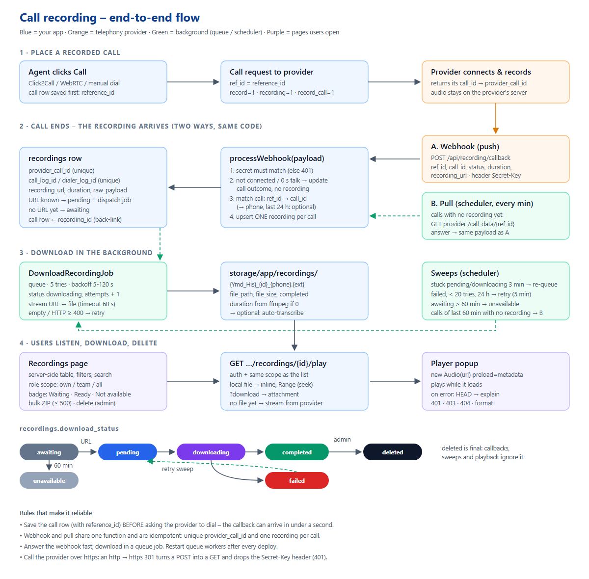

# LeadGER – Call Recording Integration Guide (workflow, endpoints, APIs)

| | |
|---|---|
| **Based on** | The working LeadGER code (Laravel 13, PHP 8.3), branch `main`, October 2026 |
| **Audience** | A developer – or Claude Code – adding call recordings to another CRM / dialer project. No LeadGER knowledge needed. |
| **What you get** | Recordings of provider calls (Click2Call, WebRTC, manual dial) saved to your server, linked to the right call, playable and downloadable in a Recordings page, with retries, role-based access and admin delete. |
| **Secrets** | Every key, URL secret and phone number is a placeholder: `<PROVIDER_SECRET_KEY>`, `<PROVIDER_BASE_URL>`, `9XXXXXXXXX`. Never copy real values into code – use `.env`. |

**Labels used in this guide**

- **[LeadGER]** – how LeadGER does it today, with the file and line (paths relative to `core/`).
- **[Proposed]** – what a new project should do. Usually the same idea, with the weaknesses found in LeadGER fixed.
- **[Provider]** – depends on your telephony provider; check their API documentation.

[[TOC]]

## 1. How to use this guide with Claude

Copy the guide (this file), `Integration_Checklist.md` and `recording-architecture.png` into the other project, e.g. `docs/recording/`. Then start Claude Code in that project and paste this prompt. Replace the parts in angle brackets.

```text
Read docs/recording/LeadGER_Call_Recording_Integration_Guide.md completely, then
docs/recording/Integration_Checklist.md.

Goal: add call recordings to this project, following the [Proposed] parts of the
guide. Our telephony provider is <provider name>; its API docs are <link or file>.
Our call tables are <table names>; calls are placed in <controller/service>.

Rules:
- First inspect this codebase and tell me how calls are placed today, where a
  call id / reference id is stored, and what the provider sends when a call ends.
  Map each guide section to our files before writing code.
- Never hard-code secrets or provider URLs: .env + config only. Use https URLs.
- Do not change existing call flows except to add reference_id and the record
  flags described in section 5.
- Build in this order: migration (8) -> service (6, 7) -> webhook (6) -> download
  job (9) -> pull + sweeps (10) -> playback (11) -> Recordings page (12) -> tests (15).
- Write the tests of section 15 with Http::fake() and Storage::fake(); no real
  provider calls in tests. Run them and show me the result.
- Tick the checklist as you go and tell me what is left.
```

> Tip: give Claude **one real webhook payload** from your provider (with the phone numbers masked). Field names differ between providers; section 6.3 lists what LeadGER accepts, and the payload shows Claude which ones yours uses.

## 2. Overview



The whole feature in seven sentences:

1. Before dialing, the app **saves the call row** with a unique `reference_id`, then asks the provider to place the call **with recording on** and passes `ref_id = reference_id`.
2. The provider records the call on its own servers. When the call ends it **calls the app's webhook** with the result and a `recording_url`.
3. The webhook (secret checked) **matches the call** by `ref_id` / provider `call_id`, and **creates or updates one `recordings` row per call** – the same callback twice changes nothing.
4. If the URL is known, a **queue job downloads** the audio to `storage/app/recordings/`; otherwise the row waits as `awaiting`.
5. A **scheduler** asks the provider every minute for calls that still have no recording (callbacks get lost), re-queues stuck downloads and gives up after 60 minutes (`unavailable`).
6. The **Recordings page** lists recordings with the same visibility rules as the calls (own / team / all) and plays them through an **authenticated endpoint** that streams the local file (with seeking) or, until it is downloaded, the provider's file.
7. Admins can **delete** a recording (file removed, row kept as `deleted` so it never comes back) and anyone allowed can **download several as a ZIP**.

What the provider must offer **[Provider]**:

| Need | Typical name | Used in |
|---|---|---|
| Place a call with recording on and your own reference | Click2Call / originate API with `ref_id`, `record=1` | 5 |
| Tell you when the call ends (CDR) with a recording link | Webhook / pingback / status callback | 6 |
| Look up one call by your reference (when a callback is lost) | "call data" / CDR lookup API | 10 |
| Recording link that your server can download | `recording_url` (http/https) | 9 |

If the provider has **no webhook**, use only the lookup (section 10) – it works, just later. If it has **no lookup**, the webhook must be reliable; keep the raw-capture table of section 6.6.

## 3. Requirements

| Item | Why |
|---|---|
| Laravel 10+ (LeadGER: 13), PHP 8.2+ with `curl`, `zip`, `fileinfo` | HTTP, ZIP download, MIME type |
| A queue (database or Redis) **and a worker kept alive** (Supervisor / systemd) | Downloads run in `DownloadRecordingJob` |
| Cron: `* * * * * cd /path/to/app && php artisan schedule:run >> /dev/null 2>&1` | Pull + sweeps every minute |
| Disk space: about **0.5–1 MB per call minute** (WAV 8 kHz mono ≈ 0.96 MB/min, MP3 ≈ 0.25 MB/min) | `storage/app/recordings` |
| Optional: `ffmpeg` (`/usr/bin/ffmpeg`) | Real duration when the provider sends none; transcription later |
| HTTPS on your app domain | The provider posts to your webhook; browsers play audio |

> **Lesson from LeadGER (October 2026):** the provider moved to HTTPS. Our `http://` URL got a **301 redirect**; on a redirect a POST becomes a GET and **custom headers such as `Secret-Key` are dropped**, so the provider answered **401** and no data came back for weeks. Always configure provider URLs with `https://`, and log the HTTP status of every provider call.

## 4. Data model at a glance

```
calls (your table, e.g. call_logs / dialer_logs)
  id, phone, agent (user_id), campaign_id, lead_id,
  reference_id  UNIQUE   <- sent to the provider as ref_id
  provider_call_id       <- the provider's call id (from the dial response or callback)
  call_state, start_time, end_time, duration
  recording_id           <- back-link to recordings.id

recordings
  id, provider_call_id UNIQUE, call_log_id UNIQUE NULL, dialer_log_id UNIQUE NULL,
  source_code (0 campaign, 2 manual, 3 standalone), user_id, lead_id, campaign_id,
  phone_number, call_date, duration, recording_url, file_path, file_size,
  download_status, download_attempts, call_status, raw_payload
```

**[LeadGER]** has two call tables – `call_logs` (campaign calls, `source_code 0`) and `dialer_logs` (manual dial, `source_code 2`) – and allows a recording with no call (`source_code 3`, "Direct Telephony"). **[Proposed]** if you have one call table, keep only `call_id` (UNIQUE) and drop `source_code`.

Full migration: section 8.

## 5. Placing a recorded call

### 5.1 Order of operations (important)

1. Create the call row **first**, with a unique `reference_id` and `call_state = 'initiated'`.
2. Send the dial request to the provider with `ref_id = reference_id` and the record flags.
3. Save the provider's `call_id` (if the response has one) as `provider_call_id`.

The provider can call your webhook **before** step 3 returns – that is why the row and its `reference_id` must exist before step 2.

**[LeadGER]** `WebRTCController::webrtcdialer` – creates the `CallLog` / `DialerLog` (`reference_id = {uuid}_d_{crm_id}_{user_id}_`, lines 336–374), then posts to the gateway with `record = recording = record_call = 1` (`webrtcdialerCall`, lines 441–445). The provider's answer is stored as `provider_call_id` (lines 414–416).

### 5.2 Reference format

Any unique string up to 191 characters works. **[Proposed]**: `"{tenant}-{call_id}-{random}"`, e.g. `acme-1042-k3f9q2`. Keep it free of the customer's phone number (it appears in provider logs and URLs).

### 5.3 Example dial request **[Provider]**

```php
// app/Services/Telephony/ProviderClient.php  [Proposed]
public function dial(Call $call, string $agentNumber, string $vmn): array
{
    $response = Http::withHeaders(['Secret-Key' => config('telephony.secret')])
        ->acceptJson()->timeout(30)->retry(2, 1000, throw: false)
        ->post(config('telephony.base_url') . '/click2call', [
            'did'             => $vmn,
            'agent_number'    => $agentNumber,
            'customer_number' => $call->phone,
            'ref_id'          => $call->reference_id,
            'record'          => 1,            // send every flag your provider documents
            'callback_url'    => route('telephony.recording.callback'),   // if the provider accepts one per call
        ]);

    Log::info('[Recording] dial', ['call' => $call->id, 'http' => $response->status()]);   // no phone numbers in logs
    if (!$response->successful()) {
        throw new ProviderException('Dial failed: HTTP ' . $response->status());
    }
    $call->update(['provider_call_id' => $response->json('call_id') ?? $call->reference_id]);
    return $response->json();
}
```

## 6. The provider webhook (recording callback)

### 6.1 Endpoint

| | **[LeadGER]** | **[Proposed]** |
|---|---|---|
| URL | `POST /api/vi_pingback_api`, `GET|POST /api/telephony/webhook`, `/api/recording/callback`, `/api/dialer/callback`, `/admin/recording/callback` – all the same handler (`routes/api.php:41-44`, `routes/web.php:53`) | **One** URL: `POST /api/telephony/recording-callback` (add GET only if the provider can only send GET) |
| Auth | Secret checked **only if one is sent** (`CallRecordingService.php:35-47`) | Secret **required**: `Secret-Key` header (or `?secret=` only if the provider cannot send headers) |
| CSRF | API routes – no CSRF | Same. If you put it in `web.php`, add it to `VerifyCsrfToken::$except` |
| Rate limit | `throttle:api` (60/min) | `throttle:300,1` – a busy dialer sends bursts |
| Trailing slash | Apache `.htaccess` answers `…/` with 301 | Give the provider the URL **without** `/`, and exclude `/api/` from the redirect (LeadGER does this since Oct 2026) |
| Response | full recording model, exception text on 500 | short JSON `{status, result}`; never echo the payload or errors |

### 6.2 Route and controller **[Proposed]**

```php
// routes/api.php
Route::post('/telephony/recording-callback', [RecordingWebhookController::class, 'handle'])
    ->middleware('throttle:300,1')->name('telephony.recording.callback');
```

```php
// app/Http/Controllers/Api/RecordingWebhookController.php
class RecordingWebhookController extends Controller
{
    public function handle(Request $request, CallRecordingService $service)
    {
        $secret = (string) config('telephony.webhook_secret');
        $given  = (string) ($request->header('Secret-Key') ?? $request->header('X-Webhook-Secret') ?? $request->query('secret', ''));
        if ($secret === '' || $given === '' || !hash_equals($secret, $given)) {
            Log::warning('[Recording] webhook refused', ['ip' => $request->ip()]);
            return response()->json(['status' => 'error', 'message' => 'Unauthorized'], 401);
        }

        $payload = $request->json()->all() ?: $request->except('secret');
        try {
            $result = $service->processWebhook($payload);          // section 7
        } catch (\Throwable $e) {
            Log::error('[Recording] webhook failed', ['error' => $e->getMessage()]);
            return response()->json(['status' => 'error'], 500);  // provider retries
        }
        return response()->json(['status' => 'ok', 'result' => $result['result']]);   // created | updated | duplicate | ignored
    }
}
```

### 6.3 Payload fields **[LeadGER]** accepts

`CallRecordingService.php:50-58, 318-368` – take the first key that is present and not empty:

| Meaning | Keys |
|---|---|
| Your reference | `ref_id`, `REF_ID`, `reference_id`, `refId` |
| Provider call id | `call_id`, `CALL_ID`, `CallId`, `uniqueid`, `unique_id`, `uuid` (fallback: the reference) |
| Customer number | `b_party_no`, `B_PARTY_NO`, `customer_number`, `phone_number`, `mobile` |
| Recording link | `recording_url`, `RecordVoice`, `record_voice`, `record_url`, `audio_url`, `file_url` |
| Status | `B_DIAL_STATUS` / `b_dial_status` (customer leg – decides the outcome), `A_DIAL_STATUS`, `status`, `call_status`, `dial_status`, `disposition` |
| Times | `B_PARTY_CONNECTED_TIME`, `B_PARTY_END_TIME`, `A_PARTY_END_TIME` (format `dmYHis`, e.g. `22102026171200`) |
| Talk time | `talk_duration`, `billsec`, `duration` |

**[Proposed]** read keys case-insensitively (`strtolower` all keys once) – fewer variants to list. Parse provider times **in the provider's timezone** (e.g. `Asia/Kolkata`) when they carry no offset.

Example (masked) **[Provider]**:

```json
{
  "ref_id": "acme-1042-k3f9q2",
  "call_id": "PRV-889211",
  "B_PARTY_NO": "9XXXXXXXXX",
  "A_DIAL_STATUS": "ANSWER",
  "B_DIAL_STATUS": "ANSWER",
  "B_PARTY_CONNECTED_TIME": "22102026171205",
  "B_PARTY_END_TIME": "22102026171410",
  "talk_duration": "125",
  "recording_url": "https://<PROVIDER_BASE_URL>/recordings/PRV-889211.wav"
}
```

### 6.4 What the webhook decides

| Case | Result | Effect |
|---|---|---|
| Wrong / missing secret | 401 | nothing saved |
| Customer leg not connected (busy, no answer, failed) | `ignored` | call gets `call_state`, `end_time`, duration 0; **no recording row** |
| Connected but 0 s talk and no URL | `ignored` | as above |
| Recording already `deleted` by an admin | `ignored` | stays deleted |
| Same callback again | `duplicate` | nothing changes (fills a missing URL only) |
| New | `created` | recording row + job (or `awaiting`) |

Valid URL rule **[LeadGER]** (`validRecordingUrl`, :748-758): `http(s)` only, passes `FILTER_VALIDATE_URL`. **[Proposed]** also check the host against an allow-list `RECORDING_URL_HOSTS` (prevents your server being used to fetch arbitrary URLs).

### 6.5 Response time

Answer in well under a second: no download in the request. Providers retry on timeouts and on 5xx, so the handler must be **idempotent** (section 7.3).

### 6.6 Optional: raw capture table **[Proposed]**

Store every webhook request first (`received_at, ip, headers without secrets, raw_body, status, failure_reason, call_id`), process it, then update the row. A wrong secret, an unknown field name or a bug then never loses a recording – you can fix the code and replay the stored events. LeadGER does this for inbound calls (`inbound_webhook_events`, Oct 2026). Keep 30 days.

## 7. Matching and saving (the service)

### 7.1 Find the call

**[LeadGER]** `findCallRecord($refId, $providerCallId, $phone)` (`CallRecordingService.php:375-398`), in this order:

1. `reference_id = ref_id` (manual-dial table, then campaign table)
2. `provider_call_id` or `webrtc_call_id = call_id`
3. `uuid LIKE ref_id%` (legacy)
4. phone number fallback: the newest call to that number in the last 24 hours

**[Proposed]** keep 1 and 2. Make the phone fallback **opt-in** (`RECORDING_MATCH_BY_PHONE=false` by default) and narrow it to calls of the last 2 hours with no recording yet – in LeadGER it can attach a recording to the wrong call when the same customer is called twice.

### 7.2 One recording per call

- `recordings.provider_call_id` UNIQUE, `call_log_id` UNIQUE, `dialer_log_id` UNIQUE.
- Reuse order: the call's `recording_id` → a row with this `provider_call_id` that belongs to this call or to no call → new row.
- If a new `provider_call_id` is already taken by another call, LeadGER appends `_d{id}` / `_c{id}` (`freeProviderCallId`, :724-731).

### 7.3 processWebhook – skeleton **[Proposed]**

```php
public function processWebhook(array $p): array
{
    $e = $this->extract($p);                                     // section 6.3, keys lower-cased
    $call = $this->findCall($e['ref_id'], $e['call_id']);

    if (!$e['connected'] || ($e['talk'] === 0 && !$e['url'])) {
        $call?->update(['call_state' => $e['state'], 'end_time' => $e['end'] ?? now(), 'duration' => 0]);
        return ['result' => 'ignored'];
    }

    return DB::transaction(function () use ($e, $call, $p) {
        $rec = $call?->recording_id ? Recording::lockForUpdate()->find($call->recording_id)
             : Recording::lockForUpdate()->where('provider_call_id', $e['call_id'])->first();

        if ($rec?->download_status === 'deleted') return ['result' => 'ignored'];

        if ($rec) {                                              // duplicate / later callback
            if ($e['url'] && !$rec->recording_url) {
                $rec->update(['recording_url' => $e['url'], 'download_status' => 'pending']);
                DownloadRecordingJob::dispatch($rec->id)->afterCommit();
            }
            return ['result' => 'duplicate'];
        }

        $rec = Recording::create([
            'provider_call_id' => $e['call_id'],
            'call_id'          => $call?->id,
            'user_id'          => $call?->user_id,
            'lead_id'          => $call?->lead_id,
            'campaign_id'      => $call?->campaign_id,
            'phone_number'     => $e['phone'],
            'call_date'        => $e['start'] ?? now(),
            'duration'         => $e['talk'],
            'recording_url'    => $e['url'],
            'download_status'  => $e['url'] ? 'pending' : 'awaiting',
            'raw_payload'      => $this->withoutSecrets($p),
        ]);
        $call?->update(['recording_id' => $rec->id, 'call_state' => 'completed',
                        'duration' => $e['talk'], 'end_time' => $call->end_time ?? $e['end'] ?? now()]);
        if ($e['url']) DownloadRecordingJob::dispatch($rec->id)->afterCommit();
        return ['result' => 'created'];
    });
}
```

Use `->afterCommit()` (or `after_commit => true` on the queue connection): **[LeadGER]** queues with `after_commit=false` inside a transaction (`DialerController.php:491`), so a worker can pick the job before the row is committed.

### 7.4 Other entry points that use the same service **[LeadGER]**

| Where | When | File |
|---|---|---|
| Live call status poll | Calling page polls `GET /admin/dialer/call-status`; once the provider reports the end, it calls `processWebhook` | `DialerController.php:1087-1159` |
| Agent saves the outcome | `storeOrUpdateRecording(...)` creates the row as `awaiting` if no callback came yet | `DialerController.php:529, 622`; `CampaignsController.php:2434` |
| Scheduler | Pull for calls without a recording | section 10 |

**[Proposed]** do **not** accept a `recording_url` from the browser (LeadGER does in `updateCallState` and `save-disposition`): only the provider and the pull may set it.

## 8. Database

### 8.1 Migration **[Proposed]** (one call table)

```php
Schema::create('recordings', function (Blueprint $t) {
    $t->id();
    $t->string('provider_call_id', 191)->unique();
    $t->foreignId('call_id')->nullable()->unique()->constrained('calls')->nullOnDelete();
    $t->foreignId('user_id')->nullable()->index();
    $t->foreignId('lead_id')->nullable()->index();
    $t->foreignId('campaign_id')->nullable()->index();
    $t->string('phone_number', 30)->index();
    $t->timestamp('call_date')->nullable()->index();
    $t->unsignedInteger('duration')->default(0);          // seconds
    $t->text('recording_url')->nullable();
    $t->string('file_path', 500)->nullable();             // relative to the recordings disk
    $t->unsignedBigInteger('file_size')->nullable();
    $t->string('download_status', 20)->default('awaiting')->index();
    $t->unsignedSmallInteger('download_attempts')->default(0);
    $t->string('call_status', 30)->default('connected');
    $t->json('raw_payload')->nullable();                  // secrets removed
    $t->timestamps();
});

Schema::table('calls', function (Blueprint $t) {
    $t->string('reference_id', 191)->nullable()->unique();
    $t->string('provider_call_id', 191)->nullable()->index();
    $t->foreignId('recording_id')->nullable()->index();
});
```

### 8.2 LeadGER's table **[LeadGER]** (`2026_10_08_010000_create_recordings_table.php`, unique indexes `2026_10_09_200000_…`)

| Column | Type | Notes |
|---|---|---|
| provider_call_id | varchar(191) UNIQUE | |
| call_id | varchar(191) idx | for AI analysis links |
| dialer_log_id / call_log_id | bigint UNIQUE NULL | manual / campaign call |
| source_code / source_type | tinyint / varchar | 0 Campaign Calling, 2 Dialing, 3 standalone |
| user_id, agent_name, lead_id, customer_name, campaign_id, campaign_name | | copied for fast listing |
| phone_number | varchar(50) idx | |
| call_date | timestamp | |
| duration | int | seconds |
| recording_url / file_path | text | provider link / absolute local path |
| file_size | bigint | |
| download_status | varchar(30) default `pending` | states in 8.3 |
| download_attempts | int | |
| call_status | varchar(50) default `connected` | |
| raw_payload | longtext | the callback |

No foreign keys. Model: `app/Models/Recording.php`. **[Proposed]** store `file_path` **relative** to a disk (portable between servers) and add the foreign keys.

### 8.3 `download_status`

| Status | Meaning | Set by |
|---|---|---|
| `awaiting` | call ended, no link yet | webhook without URL, outcome save |
| `pending` | link known, job queued | webhook / pull with URL, retry sweep |
| `downloading` | job running | job start |
| `completed` | file on disk | job success |
| `failed` | 5 attempts failed; provider link kept for playback | job |
| `unavailable` | no link 60 min after the call | sweep |
| `deleted` | removed by an admin – **final** | delete |

## 9. Download job

**[LeadGER]** `app/Jobs/DownloadRecordingJob.php`: `$tries = 5`, `$backoff = [5, 15, 30, 60, 120]`, cURL timeout 60 s, file `storage/app/recordings/{Ymd_His}_{id}_{digits}.{ext}`, extension from the URL (`wav|mp3|ogg|m4a|aac`, else `wav`), then `autoTranscribe`.

**[Proposed]** version – streams to disk, checks size and type, keeps TLS verification on:

```php
class DownloadRecordingJob implements ShouldQueue
{
    use Dispatchable, InteractsWithQueue, Queueable, SerializesModels;

    public int $tries = 5;
    public array $backoff = [5, 15, 30, 60, 120];
    public int $timeout = 120;
    private const MAX_BYTES = 200 * 1024 * 1024;
    private const TYPES = ['wav' => 'audio/wav', 'mp3' => 'audio/mpeg', 'ogg' => 'audio/ogg', 'm4a' => 'audio/mp4', 'aac' => 'audio/aac'];

    public function __construct(public int $recordingId) {}

    public function handle(): void
    {
        $rec = Recording::find($this->recordingId);
        if (!$rec || $rec->download_status === 'deleted' || !$rec->recording_url) return;
        if ($rec->download_status === 'completed' && $rec->file_path && Storage::disk('recordings')->exists($rec->file_path)) return;

        $rec->update(['download_status' => 'downloading', 'download_attempts' => $rec->download_attempts + 1]);

        $ext  = strtolower(pathinfo(parse_url($rec->recording_url, PHP_URL_PATH) ?? '', PATHINFO_EXTENSION));
        $ext  = isset(self::TYPES[$ext]) ? $ext : 'wav';
        $path = sprintf('%s/%s_%d.%s', $rec->call_date?->format('Y/m') ?? date('Y/m'), $rec->call_date?->format('Ymd_His') ?? date('Ymd_His'), $rec->id, $ext);
        $tmp  = tempnam(sys_get_temp_dir(), 'rec');

        $res = Http::timeout(60)->connectTimeout(15)->withOptions(['sink' => $tmp])->get($rec->recording_url);
        $size = filesize($tmp) ?: 0;
        if (!$res->successful() || $size === 0 || $size > self::MAX_BYTES || str_contains((string) $res->header('Content-Type'), 'text/html')) {
            @unlink($tmp);
            throw new \RuntimeException('Download failed: HTTP ' . $res->status() . ', ' . $size . ' bytes');   // retried with backoff
        }

        Storage::disk('recordings')->putFileAs(dirname($path), new File($tmp), basename($path));
        @unlink($tmp);
        $rec->update(['file_path' => $path, 'file_size' => $size, 'download_status' => 'completed',
                      'duration' => $rec->duration ?: app(AudioProbe::class)->seconds(Storage::disk('recordings')->path($path))]);
    }

    public function failed(\Throwable $e): void
    {
        Recording::whereKey($this->recordingId)->where('download_status', '!=', 'deleted')
            ->update(['download_status' => 'failed']);           // provider link kept: playback still works
        Log::error('[Recording] download gave up', ['recording' => $this->recordingId, 'error' => $e->getMessage()]);
    }
}
```

```php
// config/filesystems.php
'recordings' => ['driver' => 'local', 'root' => storage_path('app/recordings'), 'throw' => false],
```

File names: **[Proposed]** no phone number in the name (LeadGER uses it) – file names end up in ZIPs and logs.

Duration probe **[LeadGER]** (`CallRecordingService::probeAudioDuration`, :813-838): run `ffmpeg -i file` with `proc_open` and an argument array (no shell), parse `Duration: hh:mm:ss.xx`; fall back to the WAV header (`byteRate`). ffmpeg path: `FFMPEG_PATH`, then `/usr/bin/ffmpeg`, `/usr/local/bin/ffmpeg`.

## 10. Pull and sweeps (scheduler)

Callbacks get lost (provider outage, your deploy, a wrong secret). The pull asks the provider directly.

**[LeadGER]** `recordings:fetch-pending` (`app/Console/Commands/FetchPendingRecordingsCommand.php`), scheduled in `app/Console/Kernel.php:19-23`:

```php
$schedule->command('recordings:fetch-pending')->everyMinute()->withoutOverlapping(10);
$schedule->command('recordings:fetch-pending --sweep')->everyFiveMinutes()->withoutOverlapping(10);
$schedule->command('recordings:fetch-pending --sweep --sweep-minutes=1440')->dailyAt('23:30');
```

| Step | Rows | Action |
|---|---|---|
| Awaiting | `awaiting`, created in the last 24 h | ask the provider by `reference_id`; a link → `processWebhook`; older than 60 min with none → `unavailable` |
| Stuck | `pending` / `downloading` with a URL, not updated for 3 min | re-dispatch the job |
| Failed (`--sweep`) | `failed`, no file, URL, `< 20` attempts, last 24 h, untouched 10 min | back to `pending`, dispatch |
| Missed (`--sweep`) | calls of the last 60 min (daily: 24 h) with `recording_id IS NULL` | ask the provider, `processWebhook` |

Provider lookup **[LeadGER]**: `GET <PROVIDER_BASE_URL>/admin/click2call_data/{ref_id}/{vmn|default}` with header `Secret-Key: <PROVIDER_SECRET_KEY>`, timeout 5 s. Accepted only when `status == 200`, `data` is an object and `data.recording_url` is a valid URL; the payload passed on is `data.response` + `ref_id`, `call_id`, `recording_url`, `status = connected`, `talk_duration` from `data.duration`.

**[Proposed]** give each schedule its own lock name (the three commands above do not block each other in LeadGER), use `withoutOverlapping(10)` so a crashed run frees the lock, keep TLS verification on, and add a test seam:

```php
class ProviderLookup
{
    public function find(string $refId): ?array
    {
        $r = Http::withHeaders(['Secret-Key' => config('telephony.secret')])->acceptJson()->timeout(10)
            ->get(config('telephony.base_url') . '/call_data/' . rawurlencode($refId));
        if (!$r->successful()) { Log::warning('[Recording] lookup failed', ['http' => $r->status()]); return null; }
        $d = $r->json('data');
        return is_array($d) && filter_var($d['recording_url'] ?? null, FILTER_VALIDATE_URL) ? $d : null;
    }
}
```

## 11. Playback and download endpoint

**[LeadGER]** `GET /admin/reports/download-recordings/{id}/{incoming?}` → `ReportsController::downloadRecordings` (:582-775). `incoming` = `0` campaign call, `2` manual call, `3` standalone, `1` legacy inbound log.

Behaviour to keep:

- 401 when not signed in; **403** when the role may not see that call (Telecaller: own calls / assigned or public leads; Sales Person: own sales leads); **404** when deleted or missing.
- `?play=1`, a `Range` header or `Accept: audio/*` → **inline** with `Accept-Ranges: bytes` (seeking works); otherwise **attachment**.
- MIME: mp3 `audio/mpeg`, ogg `audio/ogg`, m4a `audio/mp4`, else `audio/wav`.
- File not downloaded yet → fall back to the provider link.

**[Proposed]** endpoint – one route, the same visibility query as the list, files only from the recordings disk, and the provider file **streamed through** your server instead of a redirect (the provider URL stays private):

```php
// routes/web.php (auth group)
Route::get('/recordings/{recording}/audio', [RecordingAudioController::class, 'show'])->name('recordings.audio');

public function show(Request $request, Recording $recording)
{
    abort_unless(RecordingQuery::for($request->user())->whereKey($recording->id)->exists(), 403);
    abort_if($recording->download_status === 'deleted', 404);

    $inline = $request->boolean('play') || $request->hasHeader('Range');
    $name   = 'recording_' . $recording->id . '.' . pathinfo($recording->file_path ?: 'x.wav', PATHINFO_EXTENSION);
    $disk   = Storage::disk('recordings');

    if ($recording->file_path && $disk->exists($recording->file_path)) {
        $path = $disk->path($recording->file_path);
        return $inline
            ? response()->file($path, ['Content-Type' => $this->mime($path), 'Accept-Ranges' => 'bytes'])
            : response()->download($path, $name);
    }
    abort_unless($recording->recording_url, 404);
    $upstream = Http::timeout(30)->withOptions(['stream' => true])->get($recording->recording_url);
    abort_unless($upstream->successful(), 404);
    return response()->stream(function () use ($upstream) {
        $body = $upstream->toPsrResponse()->getBody();
        while (!$body->eof()) { echo $body->read(65536); flush(); }
    }, 200, ['Content-Type' => $upstream->header('Content-Type') ?: 'audio/wav',
             'Content-Disposition' => ($inline ? 'inline' : 'attachment') . '; filename="' . $name . '"']);
}
```

Player **[LeadGER]** (`resources/views/dashboard/reports/partials/recording-player.blade.php`): `new Audio(url + '?play=1')` with `preload = 'metadata'` – starts playing at once; **only on an error** it sends a `HEAD` request to explain why (401/419 "session expired", 403 "not allowed", 404 "missing or deleted", media error 4 "format cannot be played – use Download"). Don't do the `HEAD` check before playing – it doubles the wait.

```js
function playRecording(url, el) {
  const audio = new Audio(url + (url.includes('?') ? '&' : '?') + 'play=1');
  audio.preload = 'metadata';
  audio.addEventListener('error', async () => {
    const r = await fetch(url, { method: 'HEAD', credentials: 'same-origin', redirect: 'manual' }).catch(() => null);
    const s = r ? r.status : 0;
    el.textContent = s === 401 || s === 419 ? 'Your session expired – sign in again.'
      : s === 403 ? 'You are not allowed to play this recording.'
      : s === 404 ? 'This recording is missing or was deleted.'
      : 'This format cannot be played in the browser – use Download.';
  });
  audio.play().catch(() => {});        // autoplay rules: the click that opened the player allows it
  return audio;
}
```

## 12. Recordings page

### 12.1 Routes **[LeadGER]** (`routes/dashboard.php:631-637`, prefix `/admin`, `auth`)

| Method | URI | Action |
|---|---|---|
| GET | `reports/recordings` | page |
| POST | `reports/recordingsData` | DataTables server-side list |
| DELETE | `reports/recordings/{id}/{source_code?}` | delete one |
| POST | `reports/recordings/bulk-delete` | `items[] = {id, source_code}` |
| POST | `reports/recordings/bulk-download` | build ZIP, returns `download_url` |
| GET | `reports/recordings/bulk-download/{token}` | the ZIP, once |

### 12.2 List request and response

Request (DataTables): `draw, start, length (-1 = all), order[0][column|dir], search[value]` plus filters `from_date, to_date` (Y-m-d, both required), `find_campaign`, `find_source` (`Campaign Calling` / `Dialing`), `telecaller_id` (CSV or array), `find_q`.

Response: `{draw, recordsTotal, recordsFiltered, data: [...]}`. Each row: `log_id, source_code, checkbox, id (lead), source_type (Click2Call / WebRTC / SIP / Mobile), campaign_name, called_by, phonenumber (masked), recording (status badge), duration, duration_seconds, created_at (d-M-Y h:i A), play (buttons with data-url, data-agent, data-number, data-date, data-duration)`.

**[LeadGER]** builds the list as a `UNION ALL` of campaign calls, manual calls and standalone recordings (`RecordingsController.php:92-378`). **[Proposed]** with one `recordings` table, list `recordings` joined to calls/users/leads – much simpler and indexable:

```php
class RecordingQuery
{
    public static function for(User $user): Builder
    {
        $q = Recording::query()->where('download_status', '!=', 'deleted');
        return match (true) {
            $user->isAdmin()                     => $q,
            $user->isManager()                   => $q->where(fn ($w) => $w->whereIn('campaign_id', $user->teamCampaignIds())
                                                                            ->orWhere('user_id', $user->id)),   // grouped: keeps the "deleted" filter
            default                              => $q->where('user_id', $user->id),
        };
    }
}
```

Sort only by a **whitelist** of columns (LeadGER: `RecordingsController.php:70-83`). Mask phone numbers for roles that should not see them.

### 12.3 Status badge

| Badge | When |
|---|---|
| "Waiting for recording" (spinner) | `awaiting`, or `pending`/`downloading` without a playable link |
| "Ready" | file on disk, or a provider link (also `failed` – the link still plays) |
| "Not available" | `unavailable` |

Play / Download buttons disabled when there is no audio.

### 12.4 Delete **[LeadGER]** (`CallRecordingService::deleteRecording`, :552-650)

- Permission: Admin role **and** the "delete" setting on (`Helper::canDeleteRecordings`). **[Proposed]** a permission flag (`recordings.delete`) instead of a role name.
- Only files **inside the recordings folder** are ever removed (`isInsideRecordingsFolder`).
- Files are renamed to `*.deleting` first; on a failure everything is rolled back ("Nothing was changed").
- In one transaction: status `deleted`, `file_path`, `file_size`, `recording_url` set to null; the call's links cleared; `recording_id` kept pointing at the marker – so a late callback or the pull **cannot bring it back**.
- After commit the files are unlinked; an audit line with the user id is logged. The call, lead and reports stay.

### 12.5 Bulk download (ZIP) **[LeadGER]** (`RecordingsController::bulkDownload`, :981-1096)

- 1–500 items; each checked with the same access rule; files stored uncompressed (audio does not compress); unique names `_2`, `_3`.
- Missing local file → fetched from the provider (≤ 200 MB, not HTML, TLS verified).
- ZIP in `storage/app/tmp/recording-zips`, older than 1 h purged; a 40-hex token saved in the **session** → the download link works **once** and only for that user; the file is deleted after sending.
- Response `{success, download_url, added, missing[], denied, message}`; nothing added → 403 (all denied) or 404.

## 13. Configuration

```dotenv
# .env  [Proposed]
TELEPHONY_BASE_URL=https://<PROVIDER_BASE_URL>      # https only
TELEPHONY_SECRET=<PROVIDER_SECRET_KEY>              # for calls to the provider
TELEPHONY_WEBHOOK_SECRET=<WEBHOOK_SECRET>           # the provider sends it to you (can equal the above)
TELEPHONY_TIMEZONE=Asia/Kolkata                     # provider times without an offset
RECORDING_URL_HOSTS=<provider-host>,<cdn-host>      # allowed download hosts
RECORDING_MATCH_BY_PHONE=false
FFMPEG_PATH=/usr/bin/ffmpeg
QUEUE_CONNECTION=database
```

```php
// config/telephony.php
return [
    'base_url'       => rtrim(env('TELEPHONY_BASE_URL', ''), '/'),
    'secret'         => env('TELEPHONY_SECRET'),
    'webhook_secret' => env('TELEPHONY_WEBHOOK_SECRET', env('TELEPHONY_SECRET')),
    'timezone'       => env('TELEPHONY_TIMEZONE', 'Asia/Kolkata'),
    'url_hosts'      => array_filter(explode(',', (string) env('RECORDING_URL_HOSTS', ''))),
    'match_by_phone' => (bool) env('RECORDING_MATCH_BY_PHONE', false),
];
```

**[LeadGER]** today: the provider secret, the provider host and an AES key are **hard-coded** in several files (`FetchPendingRecordingsCommand.php:41,173`, `DialerController.php:1169`, `ReportsController.php:591`, `CronsController.php`), and `TELEPHONY_WEBHOOK_SECRET` falls back to a literal in `config/services.php`. Do not copy that – read everything from config.

**Never** run `php artisan config:cache` in a project whose code calls `env()` outside config files (LeadGER does) – `env()` then returns null. In the new project, call `env()` only in `config/*.php`, then `config:cache` is safe.

## 14. Security

| Rule | Why |
|---|---|
| Webhook secret **required**, compared with `hash_equals` | LeadGER accepts callbacks without a secret |
| Secret in a header, not the query string (unless the provider cannot) | query strings end up in access logs |
| Only provider callbacks and the pull set `recording_url`; host allow-list; TLS verification on | avoids SSRF and spoofed links (LeadGER accepts a browser-sent URL and downloads with SSL verification off) |
| Playback: the same visibility query as the list; files only from the recordings disk; stream provider files instead of redirecting | LeadGER redirects to the raw provider URL and has one source (`incoming=1`) without a role check |
| No phone numbers in file names, logs or error responses; webhook answers do not echo the payload | data minimisation |
| Delete: permission check on the server, folder check, transaction, audit log | |
| Legacy unauthenticated upload endpoints: don't port them | LeadGER still has `admin/upload`, `admin/mobile_upload` |
| Retention: decide how long audio is kept (e.g. 180 days) and schedule a cleanup | LeadGER has none |

## 15. Tests

Use `Http::fake()`, `Storage::fake('recordings')`, `Queue::fake()` / `Bus::fake()`. No real provider calls.

| # | Test |
|---|---|
| 1 | Connected callback → one recording (duration, URL, `call_id`), call back-linked, job dispatched |
| 2 | Busy / no-answer callback → `ignored`, no recording, call gets outcome and duration 0 |
| 3 | Same callback twice (and two at once) → one row, second answer `duplicate` |
| 4 | Missing / wrong secret → 401, nothing saved |
| 5 | Callback without URL → `awaiting`; a later callback with URL → `pending` + job |
| 6 | Job success → file on the disk, `completed`, size set, duration probed when 0 |
| 7 | Job: HTTP 500 / empty body / HTML / > 200 MB → retried; after 5 tries `failed`, URL kept |
| 8 | Pull: an `awaiting` row gets its URL from the faked lookup; after 60 min without → `unavailable` |
| 9 | Sweep: stuck `downloading` row re-queued; `failed` row retried while `< 20` attempts |
| 10 | Playback: owner 200 inline with `Accept-Ranges`; `?download` attachment; other agent 403; deleted 404; signed out 401 |
| 11 | Playback without local file streams the provider file (faked) |
| 12 | List: role scope (agent / manager / admin), date filter, search, sort whitelist, masked numbers |
| 13 | Delete: only with permission; file removed; status `deleted`; a later callback does not revive it; locked file → nothing changed |
| 14 | Delete never touches files outside the recordings folder |
| 15 | Bulk ZIP: only allowed items, unique names, link works once and only for the same user |
| 16 | A recording URL from the browser is ignored; a URL on a host outside `RECORDING_URL_HOSTS` is refused |

**[LeadGER]** tests to read for examples: `tests/Feature/CallRecordingTest.php`, `ManualCallRecordingTest.php`, `RecordingDeletePermissionTest.php`, `RecordingTypeColumnTest.php`.

## 16. Deployment

1. `php artisan migrate --force`
2. `.env`: section 13 keys; `php artisan optimize:clear` (and `config:cache` only if `env()` is used in config files only).
3. Queue worker under Supervisor, e.g.

```ini
[program:app-worker]
command=php /var/www/app/artisan queue:work --sleep=3 --tries=1 --timeout=150
numprocs=2
autostart=true
autorestart=true
user=www-data
stopwaitsecs=180
```

   `retry_after` of the queue connection must be **larger** than the job `$timeout` (150 → 180).
4. Cron: `* * * * * cd /var/www/app && php artisan schedule:run >> /dev/null 2>&1`
5. `apt install ffmpeg` (optional).
6. Give the provider the webhook URL (https, no trailing slash) and the secret. Ask them for one **test callback**.
7. **After every deploy restart the workers** – they keep the old code in memory: `sudo supervisorctl restart app-worker:*`.
8. Place one real call, hang up after 20 s: within a minute the Recordings page shows "Ready" and it plays.

## 17. Troubleshooting

| Symptom | Check |
|---|---|
| "Waiting for recording" forever | Is the worker running (`supervisorctl status`)? Is the cron running (`grep CRON /var/log/syslog`)? `SELECT download_status, COUNT(*) FROM recordings GROUP BY 1` |
| No callbacks at all | Provider has the right URL (https, no `/` at the end)? Your logs show `[Recording] webhook refused`? Firewall/WAF allows the provider IP? |
| Provider calls return 401 | URL is `http://` and redirected (POST → GET drops the header) – use `https://`. Otherwise the secret is wrong |
| Downloads `failed` | `[Recording] download gave up` in the log: provider link expired, host not allowed, TLS error, file too big |
| Recording attached to the wrong call | Phone fallback on? Turn it off; make sure `ref_id` is sent on every dial |
| Plays but cannot seek | the endpoint must answer `Range` with `response()->file()` (206), not `download()` |
| Code change has no effect | workers not restarted after deploy |
| Times shifted by 5:30 | provider times parsed as UTC – set `TELEPHONY_TIMEZONE` |

## Appendix A – Integration Checklist

[[CHECKLIST]]

## Appendix B – LeadGER source map

| Part | File (relative to `core/`) |
|---|---|
| Webhook routes | `routes/api.php:41-44`, `routes/web.php:53` |
| Webhook controller | `app/Http/Controllers/APIs/TelephonyWebhookController.php` |
| Service: webhook, matching, save, delete, ffmpeg | `app/Services/CallRecordingService.php` |
| Download job | `app/Jobs/DownloadRecordingJob.php` |
| Pull + sweeps | `app/Console/Commands/FetchPendingRecordingsCommand.php`, schedule in `app/Console/Kernel.php` |
| Dial with record flags | `app/Http/Controllers/Dashboard/WebRTCController.php` |
| Live status poll, outcome save | `app/Http/Controllers/Dashboard/DialerController.php`, `CampaignsController.php` |
| Playback / download | `app/Http/Controllers/Dashboard/ReportsController.php::downloadRecordings` |
| Recordings page, list, delete, ZIP | `app/Http/Controllers/Dashboard/RecordingsController.php`, `resources/views/dashboard/reports/recordings.blade.php` |
| Player | `resources/views/dashboard/reports/partials/recording-player.blade.php` |
| Model, migrations | `app/Models/Recording.php`, `database/migrations/2026_10_08_010000_create_recordings_table.php`, `2026_10_09_200000_add_unique_call_id_indexes.php` |
| Tests | `tests/Feature/CallRecordingTest.php`, `ManualCallRecordingTest.php`, `RecordingDeletePermissionTest.php`, `RecordingTypeColumnTest.php` |
