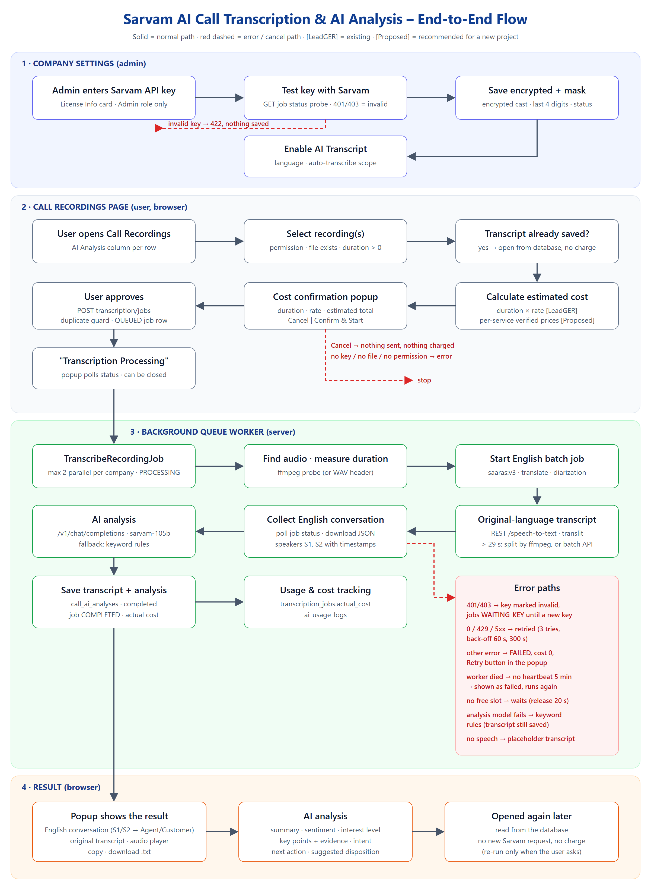

# AMETECS – Sarvam AI Call Transcription & AI Analysis Integration Guide

| | |
|---|---|
| **Based on** | The working LeadGER code (Laravel 13, PHP 8.3), branch `main`, October 2026 |
| **Audience** | Developers adding call transcription, AI call analysis, Sarvam API-key settings and a pre-transcription cost estimate to another CRM. No LeadGER knowledge needed. |
| **Sarvam facts checked** | docs.sarvam.ai (pricing and Batch Speech-to-Text pages), checked 22 October 2026. Prices change – check again before going live. |
| **Secrets** | All keys and phone numbers are placeholders (`<SARVAM_API_KEY>`, `9XXXXXXXXX`). |

**Labels used in this guide**

- **[LeadGER]** – how LeadGER does it today, with the file and line (paths are relative to `core/`).
- **[Sarvam]** – from Sarvam's public documentation.
- **[Proposed]** – recommended for a new project; LeadGER does not do this (yet).

[[TOC]]

## 1. Executive Overview

A user picks a call recording and gets three things back:

1. **The original-language transcript** – what was said, written in English letters (Sarvam "translit" mode).
2. **The conversation in English, speaker by speaker** – translated, with timestamps and speakers S1 / S2 (Sarvam batch job, "translate" mode, speaker identification). The user can mark which speaker is the agent.
3. **An AI analysis** – summary, sentiment, interest level, key points with quotes as evidence, customer intent, next action and a suggested disposition (Sarvam chat model `sarvam-105b`).

How it works in five sentences:

- Each company saves **its own Sarvam API key** in Company Settings. The key is tested with Sarvam, stored encrypted, and only its last 4 characters are ever shown.
- On the **Call Recordings** page, a user selects recordings. LeadGER shows an **estimated cost** (duration × a configured rate) and starts only after **Confirm**.
- A **queue job** does the work in the background (at most 2 at a time per company). The page shows "Queued / Processing" and can be closed.
- The worker calls **three Sarvam services**: speech-to-text, the batch speech-to-text job (translate + speakers), and chat completions for the analysis. It saves everything to `call_ai_analyses` and records the cost.
- Opening a finished transcript **reads the database** – no new Sarvam request, no new charge.

> **Most important finding for a new project – cost.** LeadGER's estimate uses one company-configured rate (default **₹0.15 per minute**, `TranscriptionBillingService.php:31-33`) for the whole pipeline. Sarvam's published prices for the same pipeline are about **₹1.25 per minute of audio plus the analysis tokens** (section 7). The LeadGER rate is a *client billing* number, not Sarvam's cost. A new project should estimate from verified, per-service prices – section 7 shows how, including "Cost estimate unavailable" when prices are not configured.



## 2. Existing LeadGER Architecture

### 2.1 Components

| Part | File (LeadGER) | Role |
|---|---|---|
| Sarvam key settings | `app/Http/Controllers/Dashboard/SarvamKeyController.php`, `app/Services/SarvamKeyService.php`, `app/Models/CompanySarvamSetting.php`, view `resources/views/dashboard/users/partials/sarvam-key-card.blade.php` | Save / test / remove the company's key, language, auto-transcribe |
| AI settings | `app/Models/CompanyAiSetting.php`, `AiCallIntelligenceController.php` | `ai_enabled`, the billing rate (`price_per_unit`) |
| Recordings page | `app/Http/Controllers/Dashboard/RecordingsController.php`, `resources/views/dashboard/recordings/recordings.blade.php` | List, AI column, cost modal, transcript popup |
| Cost + jobs | `app/Services/TranscriptionBillingService.php`, `app/Models/TranscriptionJob.php` | Estimate, job rows, actual cost |
| Queue job | `app/Jobs/TranscribeRecordingJob.php` | Runs one transcription in the background |
| Sarvam client | `app/Services/SarvamAiService.php` | All Sarvam requests, the pipeline, the analysis |
| Results | `app/Models/CallAiAnalysis.php` (table `call_ai_analyses`), `AiUsageLog.php` | Transcript, conversation, analysis, usage |
| Audio | `app/Services/CallRecordingService.php`, `app/Jobs/DownloadRecordingJob.php` | Recording files, duration probe, auto-transcribe trigger |

### 2.2 Sequence

```
BROWSER (Recordings page)              LARAVEL (web request)
 select rows, Estimate ------------->  POST transcription/estimate
 <-- duration, rate, total ----------  (no Sarvam call)
 Confirm --------------------------->  POST transcription/jobs
                                       checks, duplicate guard
                                       transcription_jobs = QUEUED
                                       call_ai_analyses   = pending
 <-- batch_id -----------------------  dispatch TranscribeRecordingJob
 poll status every 3-10 s

QUEUE WORKER                           SARVAM
 slot lock (2 per company)
 PROCESSING + heartbeat every 20 s
 create + upload + start batch job -->  translate + speakers (runs)
 POST /speech-to-text per 29 s part ->  original transcript
 poll job status, download JSON <----   English conversation
 POST /v1/chat/completions -------->    analysis JSON
 save call_ai_analyses = completed
 job COMPLETED + actual cost

BROWSER: next poll -> status completed -> transcript + analysis (read from the database)
```

### 2.3 What LeadGER does not do (yet)

These are listed so nobody copies them by mistake. Each is a **[Proposed]** improvement in this guide.

| Gap in LeadGER | Where | Proposed |
|---|---|---|
| The single-row **Transcribe / Retry** button starts the job **without the cost popup**; only "Transcribe selected" (bulk) shows the estimate. | `recordings.blade.php` `lgTranscribeOne` 2301-2324 | Every paid start goes through the estimate + confirm. |
| A **completed** recording can be transcribed again and is **charged again** (not blocked by the duplicate guard). | `TranscriptionBillingService.php:324-338` | Block unless the user explicitly chooses "Regenerate". |
| `company_ai_settings.ai_enabled` ("AI Transcript" switch) does **not** block transcription on the server; it only hides AI report pages and the analysis icon. | `RecordingsController.php:541`, `AiCallIntelligenceController.php:97,371,416,584` | One switch that every start endpoint and the auto-transcribe check. |
| The estimate is one company rate for everything; no per-service price, no tax, no "unavailable". | `TranscriptionBillingService.php:25-46, 194-274` | Section 7. |
| Cost modal: count and provider never update (wrong element ids). | `recordings.blade.php` 2837, 2842 vs 1241, 1253 | Use the right ids. |
| `getBatchStatus` returns customer names and unmasked numbers to any logged-in user. | `RecordingsController@getBatchStatus` | Check ownership / role. |
| REST speech-to-text turns TLS verification off. | `SarvamAiService.php:133, 196` | Keep TLS on. |
| Batch polling may run up to 1200 s, but the job timeout is 900 s. | `SarvamAiService.php` (deadline), `TranscribeRecordingJob.php` (`$timeout=900`) | Keep the poll deadline below the job timeout. |
| `follow_up_date`, `emotion_analysis`, `quality_flags` columns exist but are never filled. | `call_ai_analyses` | Fill them or drop them. |

## 3. System Requirements

| Item | LeadGER | New project |
|---|---|---|
| Backend | Laravel 13, PHP 8.3, cURL, `ext-json` | Laravel 10+ (examples use Laravel 11+ style), PHP 8.2+ |
| Database | MySQL 8 (one database per company) | Any SQL database supported by Laravel |
| Queue | `QUEUE_CONNECTION=database` + `queue:work` (Supervisor in production) | Required: transcription must never run inside a web request |
| Queue timeout | `config/queue.php` `database.retry_after = 960` (> job `timeout` 900) | `retry_after` must be larger than the job timeout |
| Cache | `CACHE_DRIVER=file` (locks for the 2 parallel slots) | Any store with atomic locks (database, Redis, file) |
| Scheduler | `schedule:run` every minute (recording catch-up, auto-transcribe) | Required if you auto-transcribe |
| ffmpeg | Recommended (`FFMPEG_PATH`, or `/usr/bin/ffmpeg`, `core/ffmpeg.exe`): duration probe, splitting audio over 29 s | Recommended. Without it, long audio goes through the batch API. |
| Sarvam | A Sarvam account and API key per company (dashboard.sarvam.ai) | Same |
| Storage | Recording files on the server (`storage/app/recordings`) | A private disk |

## 4. Sarvam AI Configuration

### 4.1 Settings used by LeadGER

| Setting | Where | Default [LeadGER] |
|---|---|---|
| Base URL | `config/services.php` `sarvam.base_url` (`SARVAM_BASE_URL`) | `https://api.sarvam.ai` |
| Speech-to-text model | `sarvam.stt_model` (`SARVAM_STT_MODEL`) | `saaras:v3` |
| Speech-to-text mode | `sarvam.stt_mode` (`SARVAM_STT_MODE`) | `translit` (what was said, in English letters) |
| Conversation model | `env('SARVAM_CONVERSATION_MODEL')` | `saaras:v3`, mode `translate`, `with_diarization: true` |
| Analysis model | `env('SARVAM_ANALYSIS_MODEL')` | `sarvam-105b` |
| Global fallback key | `SARVAM_API_KEY` + `SARVAM_ALLOW_GLOBAL_KEY=true` | Off. Used only when a company has **no** key; never when its key is invalid. |
| Company key | `company_sarvam_settings.sarvam_api_key` (encrypted) | Set by the admin |
| Language | `company_sarvam_settings.transcription_language` | `unknown` = auto-detect |
| Allowed languages | `CompanySarvamSetting::LANGUAGES` (line 20-24) | `unknown, en-IN, hi-IN, te-IN, ta-IN, kn-IN, ml-IN, mr-IN, bn-IN, gu-IN, pa-IN, od-IN` |

### 4.2 Sarvam services and modes **[Sarvam]**

- Speech-to-text REST: short audio (LeadGER treats over 30 s as too long; Sarvam answers "Audio duration exceeds the maximum limit of 30 seconds. Please use the batch API for longer audio files.").
- Batch Speech-to-Text: files up to 2 hours, up to 20 files per job; job states `Accepted`, `Pending`, `Running`, `Completed`, `Failed`.
- Models: `saaras:v3` (used by LeadGER) and `saaras:v4` (Sarvam's current default for batch). Modes: `transcribe`, `translate`, `verbatim`, `translit`, `codemix`. Speaker identification: `with_diarization`, optional `num_speakers`.
- Chat completions: `sarvam-105b`.

> **[Proposed]** Keep the model names in configuration (as LeadGER does) and test a model change on a few real calls before switching all companies.

## 5. Company Settings Integration (API key)

### 5.1 What LeadGER does [LeadGER]

- **Where**: Configuration → Profile → *License Info* tab (`/admin/users/{id}/edit`, `UsersController@edit`), card `sarvam-key-card.blade.php`: key field (`type=password`), masked saved key, language, auto-transcribe scope, "Transcribe new recordings automatically", this month's usage, buttons **Remove / Test / Save**.
- **Who**: only the role named `Admin` (`SarvamKeyController::denyUnlessAdmin`, lines 187-193); others get 403 and see only a status line.
- **Routes** (all `auth`, CSRF, rate-limited):

| Method | URI | Action |
|---|---|---|
| GET | `/admin/settings/sarvam-key` | Current state (never the key) – `throttle:60,1` |
| POST | `/admin/settings/sarvam-key/test` | Test a typed key (not saved), or the saved key – `throttle:10,1` |
| POST | `/admin/settings/sarvam-key` | Save key / language / scope / auto – `throttle:10,1` |
| DELETE | `/admin/settings/sarvam-key` | Remove the key; queued jobs pause – `throttle:10,1` |

- **Test** (`SarvamKeyService::test`, lines 76-99): `GET {base}/speech-to-text/job/v1/{Ymd}_00000000-0000-0000-0000-000000000000/status` with header `api-subscription-key`, 10 s timeout. The job does not exist, so nothing is processed. Result: 401/403 → **invalid**; 429 → **rate limited**; 5xx / network → **unreachable**; anything else (200/400/404/422) → **valid** (the key was accepted).
- **Save** (lines 68-136): language/scope validated; key must be 20-200 characters without spaces; a typed key is tested first – invalid → **422 "Key is invalid. Nothing was saved."**; rate-limited / unreachable → saved with "Saved without verification". Saved inside a transaction (`lockForUpdate`). Jobs that were waiting for a key resume.
- **Storage**: table `company_sarvam_settings`, column `sarvam_api_key` with Laravel's `encrypted` cast (APP_KEY), hidden from JSON; `sarvam_key_last4`; status `not_configured | connected | invalid`. Shown as `••••••••••••••••` + last 4.
- **Audit**: `sarvam_key_audit_logs` (added / replaced / removed / tested / settings_changed / invalidated, last 4, user, IP) – never the key.
- **Isolation**: one database per company; the settings row is `company_id = 1` in each company database; queue jobs carry only the company's host/database name, never the key.
- **On/off**: two different switches (see 2.3):
  - `company_sarvam_settings.auto_transcribe` + scope (`connected`, `all`, `none`) – automatic transcription of new recordings.
  - `company_ai_settings.ai_enabled` – shows/hides AI report pages; does **not** stop transcription.

### 5.2 Reusable implementation [Proposed, based on LeadGER]

**Model** – encrypted key, never serialised, masked for display:

```php
<?php
namespace App\Models;

use Illuminate\Contracts\Encryption\DecryptException;
use Illuminate\Database\Eloquent\Model;

class CompanySarvamSetting extends Model
{
    public const LANGUAGES = ['unknown', 'en-IN', 'hi-IN', 'te-IN', 'ta-IN', 'kn-IN', 'ml-IN', 'mr-IN', 'bn-IN', 'gu-IN', 'pa-IN', 'od-IN'];

    protected $fillable = ['company_id', 'sarvam_api_key', 'sarvam_key_last4', 'sarvam_key_status', 'sarvam_key_verified_at',
                           'ai_transcript_enabled', 'transcription_language', 'auto_transcribe', 'updated_by'];
    protected $hidden = ['sarvam_api_key'];
    protected $casts = ['sarvam_api_key' => 'encrypted', 'sarvam_key_verified_at' => 'datetime',
                        'ai_transcript_enabled' => 'boolean', 'auto_transcribe' => 'boolean'];

    /** One row per company (LeadGER: one per company database, company_id = 1). */
    public static function forCompany(int $companyId): self
    {
        return static::firstOrCreate(['company_id' => $companyId], ['sarvam_key_status' => 'not_configured', 'transcription_language' => 'unknown']);
    }

    public function apiKey(): ?string
    {
        try { return $this->sarvam_api_key ?: null; } catch (DecryptException $e) { return null; }   // APP_KEY changed
    }

    public function usable(): bool
    {
        return $this->ai_transcript_enabled && $this->sarvam_key_status === 'connected' && $this->apiKey() !== null;
    }

    public function maskedKey(): ?string
    {
        return $this->sarvam_key_last4 ? str_repeat('•', 16) . $this->sarvam_key_last4 : null;
    }
}
```

**Key test** – the same free probe as LeadGER:

```php
public function testKey(string $key): array   // ['state' => valid|invalid|rate_limited|unreachable, 'message' => ...]
{
    try {
        $probe = now()->format('Ymd') . '_00000000-0000-0000-0000-000000000000';
        $code = Http::timeout(10)->connectTimeout(10)->acceptJson()
            ->withHeaders(['api-subscription-key' => $key])
            ->get(rtrim(config('sarvam.base_url'), '/') . "/speech-to-text/job/v1/{$probe}/status")->status();
    } catch (\Throwable $e) {
        return ['state' => 'unreachable', 'message' => 'Could not reach Sarvam. Try again'];
    }
    return match (true) {
        in_array($code, [401, 403], true) => ['state' => 'invalid', 'message' => 'Key is invalid'],
        $code === 429 => ['state' => 'rate_limited', 'message' => 'Quota or rate limit reached. Try again later'],
        $code >= 500 => ['state' => 'unreachable', 'message' => 'Could not reach Sarvam. Try again'],
        default => ['state' => 'valid', 'message' => 'Key verified'],   // 2xx/400/404/422 = the key was accepted
    };
}
```

**Controller** – admin only, never returns the key:

```php
class SarvamSettingsController extends Controller
{
    public function __construct()
    {
        $this->middleware(['auth', 'can:manage-ai-settings', 'throttle:10,1']);   // define the gate for your admins
    }

    public function show(Request $request)
    {
        return response()->json($this->state($this->settings($request)));
    }

    public function test(Request $request, SarvamClient $sarvam)
    {
        $key = $request->input('key') ?: $this->settings($request)->apiKey();
        abort_unless($key, 422, 'Enter a key first.');
        $r = $sarvam->testKey($key);
        if (!$request->filled('key')) {   // testing the saved key updates its status
            $s = $this->settings($request);
            $s->update(['sarvam_key_status' => $r['state'] === 'valid' ? 'connected' : ($r['state'] === 'invalid' ? 'invalid' : $s->sarvam_key_status),
                        'sarvam_key_verified_at' => $r['state'] === 'valid' ? now() : $s->sarvam_key_verified_at]);
        }
        return response()->json($r, match ($r['state']) { 'valid' => 200, 'invalid' => 422, default => 503 });
    }

    public function save(Request $request, SarvamClient $sarvam)
    {
        $data = $request->validate([
            'key' => ['nullable', 'string', 'min:20', 'max:200', 'not_regex:/\s/'],
            'enabled' => ['required', 'boolean'],
            'language' => ['required', Rule::in(CompanySarvamSetting::LANGUAGES)],
            'auto_transcribe' => ['required', 'boolean'],
        ]);
        $s = $this->settings($request);
        $warning = null;
        if (!empty($data['key'])) {
            $r = $sarvam->testKey($data['key']);
            if ($r['state'] === 'invalid') {
                return response()->json(['message' => 'Key is invalid. Nothing was saved.'], 422);
            }
            $warning = $r['state'] === 'valid' ? null : 'Saved without verification: ' . $r['message'];
            $s->fill(['sarvam_api_key' => $data['key'], 'sarvam_key_last4' => substr($data['key'], -4),
                      'sarvam_key_status' => 'connected', 'sarvam_key_verified_at' => $r['state'] === 'valid' ? now() : null]);
        }
        $s->fill(['ai_transcript_enabled' => $data['enabled'], 'transcription_language' => $data['language'],
                  'auto_transcribe' => $data['auto_transcribe'] && $s->apiKey(), 'updated_by' => $request->user()->id])->save();
        Log::info('[Sarvam] settings saved', ['company' => $s->company_id, 'key' => $s->sarvam_key_last4 ? '****' . $s->sarvam_key_last4 : null]);
        return response()->json($this->state($s) + ['warning' => $warning]);
    }

    public function destroy(Request $request)
    {
        $this->settings($request)->update(['sarvam_api_key' => null, 'sarvam_key_last4' => null, 'sarvam_key_status' => 'not_configured',
                                           'sarvam_key_verified_at' => null, 'auto_transcribe' => false]);
        return response()->json(['message' => 'Key removed.']);
    }

    private function settings(Request $request): CompanySarvamSetting
    {
        return CompanySarvamSetting::forCompany($request->user()->company_id);   // ADAPT: your company / tenant id
    }

    private function state(CompanySarvamSetting $s): array   // never the key itself
    {
        return ['status' => $s->sarvam_key_status, 'masked_key' => $s->maskedKey(), 'enabled' => $s->ai_transcript_enabled,
                'language' => $s->transcription_language, 'auto_transcribe' => $s->auto_transcribe,
                'verified_at' => optional($s->sarvam_key_verified_at)->toIso8601String()];
    }
}
```

**Settings card** (Blade + JavaScript, posts JSON with the CSRF token; the key field is never pre-filled):

```html
<div class="card" id="sarvam-card">
  <h3>Sarvam AI Configuration</h3>
  <p>Status: <b id="sv-status">{{ $state['status'] }}</b> <span id="sv-masked">{{ $state['masked_key'] }}</span></p>
  <label><input type="checkbox" id="sv-enabled" @checked($state['enabled'])> Enable AI Transcript</label>
  <label>Sarvam AI API key <input type="password" id="sv-key" autocomplete="off" placeholder="Enter a new key to replace the saved one"></label>
  <label>Language <select id="sv-language">@foreach($languages as $code => $name)<option value="{{ $code }}" @selected($state['language'] === $code)>{{ $name }}</option>@endforeach</select></label>
  <label><input type="checkbox" id="sv-auto" @checked($state['auto_transcribe'])> Transcribe new recordings automatically</label>
  <button type="button" id="sv-test">Test API Connection</button>
  <button type="button" id="sv-save">Save Configuration</button>
  <button type="button" id="sv-remove">Remove key</button>
  <p id="sv-msg" role="status"></p>
</div>
<script>
(function () {
  const $ = (id) => document.getElementById(id);
  const token = document.querySelector('meta[name="csrf-token"]').content;
  const send = (method, url, body) => fetch(url, { method, credentials: 'same-origin',
      headers: { 'Content-Type': 'application/json', Accept: 'application/json', 'X-CSRF-TOKEN': token },
      body: body ? JSON.stringify(body) : undefined })
    .then(r => r.json().catch(() => ({})).then(d => ({ ok: r.ok, d })));
  const show = (text, ok) => { $('sv-msg').textContent = text; $('sv-msg').style.color = ok ? '#047857' : '#B91C1C'; };
  $('sv-test').onclick = () => send('POST', '{{ route('sarvam.test') }}', { key: $('sv-key').value.trim() || null })
    .then(({ ok, d }) => show(d.message || (ok ? 'Key verified' : 'Test failed'), ok));
  $('sv-save').onclick = () => {
    const key = $('sv-key').value.trim();
    if (key && (key.length < 20 || /\s/.test(key))) return show('The key looks wrong (20-200 characters, no spaces).', false);
    send('POST', '{{ route('sarvam.save') }}', { key: key || null, enabled: $('sv-enabled').checked,
        language: $('sv-language').value, auto_transcribe: $('sv-auto').checked })
      .then(({ ok, d }) => {
        if (!ok) return show(d.message || 'Not saved', false);
        $('sv-key').value = '';                       // never keep the key in the page
        $('sv-status').textContent = d.status; $('sv-masked').textContent = d.masked_key || '';
        show(d.warning || 'Saved', !d.warning);
      });
  };
  $('sv-remove').onclick = () => confirm('Remove the Sarvam key? Transcription stops until a new key is saved.')
    && send('DELETE', '{{ route('sarvam.destroy') }}').then(() => location.reload());
})();
</script>
```

## 6. Call Recording Integration

### 6.1 The Recordings page [LeadGER]

- Page `GET /admin/reports/recordings`; table data `POST /admin/reports/recordingsData` (DataTables, server side). Columns: checkbox, Lead ID, Employee Name, Mobile (masked), Campaign, Type, File Name, Duration, Date & Time, Actions (download, play, view transcript), **AI Analysis**.
- Rows come from three sources (campaign calls, manual calls, standalone recordings), each joined to `call_ai_analyses`.
- **AI Analysis column states**: Completed (opens the popup) · Transcribing · Waiting for API key · Pending · Failed + **Retry** · Preparing audio · Not set up (no key) · **Transcribe** button · Waiting for recording · Not transcribed.
- A row can be transcribed only if the user may request transcripts **and** the audio file exists **and** it is not still downloading **and** duration > 0 (`RecordingsController.php:428`).
- With no key, an amber banner explains it; admins get a link to the key settings.

### 6.2 Checks before anything is queued [LeadGER]

`POST /admin/reports/recordings/transcription/jobs` (`startTranscriptionJobs`, 842-885) → `createTranscriptionJobs` (287-388):

1. Logged in; role is Super Admin, Admin, Webmaster or Manager (`canRequestTranscript`, 602-606) – else 403.
2. The user may see each recording (`rowAccessError`: team / own calls for Telecaller and Sales Person) – else 403.
3. A usable Sarvam key – else 422 with "not set up" message.
4. Each recording: record exists; audio file exists and is not empty; not still downloading; duration > 0 – otherwise it is listed under `skipped` with the reason.
5. Duplicate guard: skipped if a job is already Queued / Processing / Waiting for key for it (a job whose worker died is marked failed first).
6. Then: a `transcription_jobs` row (status `QUEUED`, rate and estimated cost stored) and `call_ai_analyses.status = pending`; one queue job per recording.

### 6.3 Existing transcript [LeadGER]

`GET /admin/reports/recordings/transcript/{id}/{source_code}` (`getTranscript`) reads the database only – no Sarvam request, no charge. While a job runs it returns `progress: {state: queued|processing, seconds, duration}`; a job without a heartbeat for 5 minutes is reported as failed with Retry.

### 6.4 Required flow in a new project [Proposed]

1. User clicks **AI Transcript** on a row (or selects several).
2. Server checks, in this order: AI Transcript enabled for the company → key configured and `connected` → user allowed for this recording → file exists, readable, supported format, duration > 0 → transcript already completed?
3. **Completed** → open it from the database. Offer **Regenerate** separately (it is a new paid request).
4. Not completed → show the **cost estimate** (section 7) → wait for **Confirm** → queue.

```php
// Every paid start passes here (estimate AND start use the same checks)
public function eligibility(User $user, Recording $rec, bool $regenerate = false): ?string
{
    $s = CompanySarvamSetting::forCompany($user->company_id);
    if (!$s->ai_transcript_enabled) return 'AI Transcript is turned off in Company Settings.';
    if (!$s->usable())              return 'Sarvam AI is not set up. Ask an admin to add the API key.';
    if (!$user->can('transcribe', $rec)) return 'You are not allowed to transcribe this recording.';
    $path = $rec->localAudioPath();   // ADAPT
    if (!$path || !is_readable($path) || filesize($path) === 0) return 'The recording file is not available.';
    if (!in_array(strtolower(pathinfo($path, PATHINFO_EXTENSION)), ['wav', 'mp3', 'ogg', 'm4a', 'aac'], true)) return 'Unsupported audio format.';
    if (AudioDuration::seconds($path) <= 0) return 'The recording has no audio.';
    $a = CallAnalysis::where('recording_id', $rec->id)->first();
    if ($a && in_array($a->status, ['pending', 'processing'], true)) return 'A transcript is already being processed.';
    if ($a && $a->status === 'completed' && !$regenerate) return 'already_completed';   // show the saved result
    return null;
}
```

## 7. Transcription Cost Estimation

### 7.1 What LeadGER does today [LeadGER]

- **Rate**: `company_ai_settings.price_per_unit` (default **0.1500**), unit `minute`, currency `INR` (`TranscriptionBillingService::getProviderPricing`, 25-46). Set in AI Call Intelligence settings, labelled "Provider Rate (₹ / min)" with help text "Dynamic client billing rate". It is **one rate for the whole pipeline** – speech-to-text, the translate + speaker job and the analysis are not priced separately.
- **Duration**: the call's talk time, else `recordings.duration`, else the audio file is measured (ffmpeg or WAV header) (`getRecordingDetails`, 55-160).
- **Estimate** (`calculateEstimate`, 194-274): per recording `billable_minutes = round(seconds / 60, 2)` and `estimated_cost = round(billable_minutes × rate, 4)`; total = `round(total_seconds / 60, 2) × rate`, 2 decimals. No minimum, no rounding up to whole minutes, no tax.
- **Endpoint**: `POST /admin/reports/recordings/transcription/estimate` with `recordings: ["0_12", "2_45"]` (source code `_` id) → JSON with `recording_count`, `total_duration_formatted`, `total_billable_minutes`, `unit_rate`, `currency_symbol`, `total_estimated_cost_formatted`, `breakdown[]` (per call: duration, minutes, cost, `already_transcribed`) and `skipped[]`.
- **Modal** `#lg-cost-estimate-modal`: number of recordings, total duration, provider, rate (`₹x.xxxx / minute`), billable minutes, **Estimated Total Cost**, details table, **Cancel / Confirm & Start Transcript**.
- **Actual cost** after processing: the measured audio length × the rate stored on the job at queue time → `transcription_jobs.actual_cost`, `call_ai_analyses.ai_cost`, `ai_usage_logs.usage_amount`. A failed job costs 0.

### 7.2 Sarvam's published prices [Sarvam, checked 22 Oct 2026]

| Service | Price | Billing |
|---|---|---|
| Speech to Text | ₹30 per hour of audio | per second, rounded up per request |
| Speech to Text with Diarization (speakers) | ₹45 per hour | per second |
| Speech to Text and Translate | ₹30 per hour | per second |
| Speech to Text, Translate and Diarization | ₹45 per hour | per second |
| `sarvam-105b` chat | ₹15 per 1M input tokens, ₹5 per 1M cached input, ₹60 per 1M output tokens | per token |

All prices in Indian Rupees. The pricing page does not mention GST – check your Sarvam invoice for tax.

### 7.3 What one LeadGER-style transcription really uses

| Step | Sarvam service | Price per audio minute |
|---|---|---|
| 1. Original transcript (`translit`) | Speech to Text | ₹0.50 |
| 2. English conversation (`translate` + speakers) | STT + Translate + Diarization | ₹0.75 |
| 3. Analysis | `sarvam-105b`, tokens | depends on the transcript length (see formula) |
| **Speech total** | | **₹1.25 per minute** + analysis |

Notes:

- Long audio split into 29-second parts sends several requests; each is rounded up to the next second, so the speech total can be a few seconds' worth higher.
- Re-running a completed recording pays for all three steps again.
- **LeadGER's default rate (₹0.15/min) is far below this.** If that rate is what you charge clients, you are charging below Sarvam's cost. Treat `price_per_unit` as a *client price* and calculate the *provider cost* separately.

### 7.4 Proposed estimator [Proposed]

Rules:

1. Prices come **only from configuration** that someone verified (with the date). No price in code.
2. If any needed price is missing → **"Cost estimate unavailable"** (the user may still be allowed to continue if your policy says so, but no number is invented).
3. Show each paid step separately, then the total; say clearly that it is an estimate.
4. Use the measured audio length when the file is local (ffmpeg / WAV header), else the stored call duration.

```php
// config/sarvam.php  (values from https://www.sarvam.ai/api-pricing - verify before use)
'pricing' => [
    'verified_on'          => env('SARVAM_PRICES_VERIFIED_ON'),            // e.g. 2026-10-22
    'currency'             => 'INR',
    'stt_per_hour'         => env('SARVAM_PRICE_STT_PER_HOUR'),             // 30
    'stt_translate_diarize_per_hour' => env('SARVAM_PRICE_STT_TRANSLATE_DIARIZE_PER_HOUR'), // 45
    'llm_input_per_million'  => env('SARVAM_PRICE_LLM_INPUT_PER_MILLION'),  // 15
    'llm_output_per_million' => env('SARVAM_PRICE_LLM_OUTPUT_PER_MILLION'), // 60
    'tax_percent'          => env('SARVAM_TAX_PERCENT', 0),                 // e.g. 18 if you add GST
    'client_markup_percent'=> env('AI_CLIENT_MARKUP_PERCENT', 0),           // your margin, if you bill clients
],
```

```php
<?php
namespace App\Services\Ai;

class CostEstimator
{
    /** Words spoken per minute and tokens per word: rough averages for the analysis estimate. */
    private const WORDS_PER_MINUTE = 150, TOKENS_PER_WORD = 1.6, PROMPT_TOKENS = 400, OUTPUT_TOKENS = 700;

    /** @return array{available: bool, lines: array, total: ?float, currency: string, note: string} */
    public function estimate(int $seconds): array
    {
        $p = config('sarvam.pricing');
        $need = ['stt_per_hour', 'stt_translate_diarize_per_hour', 'llm_input_per_million', 'llm_output_per_million'];
        foreach ($need as $k) {
            if (!is_numeric($p[$k] ?? null)) {
                return ['available' => false, 'lines' => [], 'total' => null, 'currency' => $p['currency'] ?? 'INR',
                        'note' => 'Cost estimate unavailable: Sarvam prices are not configured.'];
            }
        }
        $hours = $seconds / 3600;
        $inTokens = self::PROMPT_TOKENS + ($seconds / 60) * self::WORDS_PER_MINUTE * self::TOKENS_PER_WORD;
        $lines = [
            'Transcription (speech to text)'           => $hours * $p['stt_per_hour'],
            'English conversation (translate + speakers)' => $hours * $p['stt_translate_diarize_per_hour'],
            'AI analysis (approx.)'                    => $inTokens / 1e6 * $p['llm_input_per_million'] + self::OUTPUT_TOKENS / 1e6 * $p['llm_output_per_million'],
        ];
        $sub = array_sum($lines);
        $tax = $sub * ((float)($p['tax_percent'] ?? 0)) / 100;
        return [
            'available' => true,
            'lines' => array_map(fn ($v) => round($v, 2), $lines) + ($tax > 0 ? ['Tax' => round($tax, 2)] : []),
            'total' => round($sub + $tax, 2),
            'currency' => $p['currency'],
            'note' => 'Estimate based on Sarvam prices verified on ' . ($p['verified_on'] ?: 'an unknown date')
                . '. The actual charge depends on the exact audio length and the length of the analysis.',
        ];
    }
}
```

Example: a **2 minutes 30 seconds** call at the prices above:

| Line | Calculation | Estimate |
|---|---|---|
| Transcription | 150 s / 3600 × ₹30 | ₹1.25 |
| English conversation | 150 s / 3600 × ₹45 | ₹1.88 |
| AI analysis (approx.) | (400 + 2.5 × 150 × 1.6) tokens × ₹15/1M + 700 × ₹60/1M | ₹0.05 |
| **Estimated total** | | **₹3.18** (before tax) |

### 7.5 Estimate vs actual

- The estimate may use the stored call duration; the actual cost uses the measured file length.
- Analysis tokens depend on how much was said; the model may also use reasoning tokens.
- Sarvam rounds each request up to the next second; split audio means more requests.
- **[Proposed]** After processing, store the provider's `request_id`s and the measured seconds per step, and reconcile monthly with the Sarvam dashboard.

### 7.6 Confirmation popup [Proposed, based on LeadGER's modal]

```
Call Transcript & AI Analysis
-------------------------------------------------
Lead ID: #10025          Employee: <agent name>
Recording duration: 02:30   Language: Auto detect
AI provider: Sarvam AI (saaras:v3, sarvam-105b)

Transcription (speech to text) ............ ₹1.25
English conversation (translate + speakers) ₹1.88
AI analysis (approx.) ..................... ₹0.05
Estimated total ........................... ₹3.18
Estimate based on Sarvam prices verified on 2026-10-22.

                 [ Cancel ]  [ Generate Transcript & Analysis ]
```

If the estimator returns `available: false`, show **"Cost estimate unavailable"** instead of the lines.

## 8. API Integration (Sarvam)

**Authentication [LeadGER / Sarvam]**: HTTP header `api-subscription-key: <SARVAM_API_KEY>`. LeadGER also sends `Authorization: Bearer <SARVAM_API_KEY>` on the batch and chat requests (`SarvamAiService.php:427`) – **[Proposed]** send only `api-subscription-key` unless Sarvam requires otherwise for an endpoint. Base URL `https://api.sarvam.ai`.

### 8.1 Speech to Text (REST, short audio)

| | |
|---|---|
| Method / URL | `POST https://api.sarvam.ai/speech-to-text` |
| Body | `multipart/form-data`: `file` (audio), `model` (`saaras:v3`), `mode` (`translit`, sent only for saaras:v3), `language_code` (`unknown` or e.g. `te-IN`) |
| Timeout [LeadGER] | 60 s |
| Fields read | `transcript`, `language_code`, `language_probability`, `request_id` |
| Limit | about 30 s of audio – longer: split into 29 s parts (ffmpeg `-ac 1 -ar 16000 -f segment -segment_time 29`) or use the batch API |

```php
$res = Http::timeout(60)->withHeaders(['api-subscription-key' => $key])
    ->attach('file', fopen($path, 'r'), basename($path), ['Content-Type' => 'audio/wav'])
    ->post("{$base}/speech-to-text", ['model' => 'saaras:v3', 'mode' => 'translit', 'language_code' => $language]);
// 200 -> ['transcript' => '...', 'language_code' => 'te-IN', 'request_id' => '...']
```

### 8.2 Batch Speech to Text (translate + speakers, long audio)

| Step | Request | Read |
|---|---|---|
| 1. Create job | `POST /speech-to-text/job/v1` `{"job_parameters": {"model": "saaras:v3", "mode": "translate", "language_code": "unknown", "with_diarization": true}}` | `job_id` |
| 2. Upload link | `POST /speech-to-text/job/v1/upload-files` `{"job_id": "...", "files": ["call_12.wav"]}` | `upload_urls["call_12.wav"].file_url` |
| 3. Upload | `PUT <file_url>` with the raw audio, headers `x-ms-blob-type: BlockBlob`, `Content-Type: audio/wav` (LeadGER: 120 s timeout, 3 tries) | HTTP 2xx |
| 4. Start | `POST /speech-to-text/job/v1/{job_id}/start` | – |
| 5. Status | `GET /speech-to-text/job/v1/{job_id}/status` every 2 s | `job_state` (`Completed` / `Failed`), `job_details[0].state` (`Success`), `job_details[0].outputs[0].file_name` |
| 6. Result link | `POST /speech-to-text/job/v1/download-files` `{"job_id": "...", "files": ["0.json"]}` | `download_urls["0.json"].file_url` |
| 7. Result | `GET <file_url>` | `transcript`, `language_code`, `diarized_transcript.entries[]` `{speaker_id, start_time_seconds, end_time_seconds, transcript}` |

LeadGER starts this job **first** and does step 1 of section 8.1 while Sarvam works, then collects the result (saves time). Speakers are renamed `S1`, `S2`… in the order they first speak. Polling deadline in LeadGER: `min(1200, 60 + 2 × duration)` seconds.

**Example result (shape, shortened):**

```json
{
  "request_id": "<id>",
  "language_code": "te-IN",
  "transcript": "Hello, am I speaking with ...",
  "diarized_transcript": { "entries": [
    { "speaker_id": "0", "start_time_seconds": 0.4, "end_time_seconds": 3.1, "transcript": "Hello, am I speaking with ..." },
    { "speaker_id": "1", "start_time_seconds": 3.4, "end_time_seconds": 5.0, "transcript": "Yes, tell me." }
  ] }
}
```

### 8.3 Chat completions (analysis)

| | |
|---|---|
| Method / URL | `POST https://api.sarvam.ai/v1/chat/completions` |
| Body [LeadGER] | `model: sarvam-105b`, `temperature: 0.1`, `reasoning_effort: "low"`, `max_tokens: 6000`, `response_format: {"type": "json_object"}`, `messages: [system, user]` |
| Timeout | 180 s |
| Read | `choices[0].message.content` (JSON text; code fences stripped) |

Details in section 12.

### 8.4 Errors, timeouts, retries

| Answer | Meaning | LeadGER behaviour |
|---|---|---|
| 401 / 403 | Key rejected | Key marked **invalid**; this and all queued jobs wait for a new key (`WAITING_KEY`); nothing retried |
| 429 | Rate limit / quota | JSON calls retried up to 3 times (2 s, 4 s); then the job is re-queued (60 s, then 300 s) |
| 5xx, network (HTTP 0) | Temporary | Same as 429 |
| 400 / 422 | Bad request (e.g. "Audio duration exceeds the maximum limit of 30 seconds…") | Too long → batch API; otherwise the job fails with the message |
| Batch `Failed` | Sarvam could not process | Job fails with `error_message` from Sarvam |

Timeouts [LeadGER]: key test 10 s; REST STT 60 s; JSON calls 60 s (connect 15 s); upload 120 s; analysis 180 s; whole job 900 s.

**Example failed response** (shape seen by LeadGER):

```json
{ "message": "Audio duration exceeds the maximum limit of 30 seconds. Please use the batch API for longer audio files.",
  "code": "invalid_request_error", "request_id": "<id>" }
```

## 9. Backend Implementation

### 9.1 Reusable vs LeadGER-specific

| Reusable as is (logic) | LeadGER-specific – replace |
|---|---|
| Key test probe, encrypted key storage, masking, audit | One database per company (`App\Support\Tenancy`), `company_id = 1` |
| REST STT, 29 s splitting, batch job flow, chat analysis, prompt, JSON mapping | Roles by name (`Admin`, `Manager`, `Telecaller`, `Sales Person`) |
| Queue job with 2 slots per company, heartbeat, retry rules | Three recording sources (`call_logs`, `dialer_logs`, standalone) and the `call_id` offsets 9000000 / 8000000 |
| Status model (queued / processing / completed / failed / waiting_key) | The License Info page, the `company_ai_settings` billing rate |
| Existing result read from the database | Lead / campaign joins on the Recordings page |

### 9.2 Routes [Proposed]

```php
Route::middleware(['auth'])->prefix('ai')->name('ai.')->group(function () {
    Route::get('/settings/sarvam', [SarvamSettingsController::class, 'show'])->name('sarvam.show');
    Route::post('/settings/sarvam/test', [SarvamSettingsController::class, 'test'])->name('sarvam.test');
    Route::post('/settings/sarvam', [SarvamSettingsController::class, 'save'])->name('sarvam.save');
    Route::delete('/settings/sarvam', [SarvamSettingsController::class, 'destroy'])->name('sarvam.destroy');

    Route::post('/recordings/estimate', [TranscriptionController::class, 'estimate'])->name('estimate');
    Route::post('/recordings/transcribe', [TranscriptionController::class, 'start'])->middleware('throttle:20,1')->name('start');
    Route::get('/recordings/{recording}/transcript', [TranscriptionController::class, 'show'])->name('show');
});
```

### 9.3 Start endpoint (estimate → confirm → queue)

```php
public function start(Request $request, CostEstimator $costs)
{
    $data = $request->validate(['recording_ids' => ['required', 'array', 'max:50'], 'recording_ids.*' => ['integer'],
                                'regenerate' => ['boolean'], 'confirmed' => ['accepted']]);   // the popup sends confirmed=1
    $user = $request->user();
    $queued = $skipped = [];
    foreach (Recording::whereIn('id', $data['recording_ids'])->get() as $rec) {
        $why = $this->eligibility($user, $rec, (bool)($data['regenerate'] ?? false));
        if ($why) { $skipped[] = ['id' => $rec->id, 'reason' => $why]; continue; }

        $seconds = AudioDuration::seconds($rec->localAudioPath());
        $estimate = $costs->estimate($seconds);
        $job = DB::transaction(function () use ($rec, $user, $seconds, $estimate) {
            // one active job per recording: unique index on (recording_id, active) or a locked check
            $analysis = CallAnalysis::lockForUpdate()->firstOrNew(['recording_id' => $rec->id, 'company_id' => $user->company_id]);
            if (in_array($analysis->status, ['pending', 'processing'], true)) return null;
            $analysis->fill(['status' => 'pending', 'error_message' => null])->save();
            return TranscriptionJob::create(['company_id' => $user->company_id, 'recording_id' => $rec->id, 'requested_by' => $user->id,
                'duration_seconds' => $seconds, 'estimated_cost' => $estimate['total'], 'status' => 'QUEUED']);
        });
        if (!$job) { $skipped[] = ['id' => $rec->id, 'reason' => 'Already being processed.']; continue; }
        TranscribeRecordingJob::dispatch($job->id);
        $queued[] = $rec->id;
    }
    return response()->json(['queued' => $queued, 'skipped' => $skipped], $queued ? 202 : 422);
}
```

### 9.4 Queue job (same rules as LeadGER's `TranscribeRecordingJob`)

```php
class TranscribeRecordingJob implements ShouldQueue
{
    use Dispatchable, InteractsWithQueue, Queueable;

    private const MAX_PARALLEL = 2;   // per company, to stay under Sarvam's rate limits
    private const API_TRIES = 3;
    public $timeout = 900;             // queue retry_after must be larger (LeadGER: 960)
    public $maxExceptions = 3;

    public function __construct(public int $jobId) {}

    public function retryUntil() { return now()->addHours(6); }   // waiting for a free slot must not use up the tries

    public function handle(TranscriptionPipeline $pipeline): void
    {
        $job = TranscriptionJob::find($this->jobId);
        if ($job && $job->isStalled()) { $job->update(['status' => 'QUEUED']); }    // its worker died: run again
        if (!$job || $job->status !== 'QUEUED') return;

        $lock = null;
        for ($slot = 1; $slot <= self::MAX_PARALLEL && !$lock; $slot++) {
            $l = Cache::lock("sarvam:{$job->company_id}:{$slot}", $this->timeout + 60);
            if ($l->get()) $lock = $l;
        }
        if (!$lock) { $this->release(20); return; }

        $triesKey = "sarvam-tries:{$job->id}";
        $tries = (int) Cache::get($triesKey, 0);
        try {
            $result = $pipeline->run($job, mayRetry: $tries + 1 < self::API_TRIES);
        } finally {
            $lock->release();
        }
        if ($result === 'retry') {
            Cache::put($triesKey, $tries + 1, now()->addHours(6));
            $this->release([60, 300][$tries] ?? 300);
            return;
        }
        Cache::forget($triesKey);
    }

    public function failed(\Throwable $e): void
    {
        TranscriptionJob::whereKey($this->jobId)->whereIn('status', ['QUEUED', 'PROCESSING'])
            ->update(['status' => 'FAILED', 'error_message' => 'Transcription stopped unexpectedly.']);
    }
}
```

### 9.5 Pipeline (same order as LeadGER's `processCallTranscription`)

```php
public function run(TranscriptionJob $job, bool $mayRetry): string   // 'done' | 'failed' | 'retry' | 'waiting_key'
{
    $settings = CompanySarvamSetting::forCompany($job->company_id);
    if (!$settings->usable()) { $job->update(['status' => 'WAITING_KEY']); return 'waiting_key'; }
    $sarvam = new SarvamClient($settings->apiKey(), $settings->transcription_language,
        onProgress: fn () => $job->touch());                       // heartbeat: a dead worker is detectable
    $job->update(['status' => 'PROCESSING']);
    $analysis = CallAnalysis::where('recording_id', $job->recording_id)->firstOrFail();
    $analysis->update(['status' => 'processing']);

    try {
        $path = $job->recording->localAudioPath();
        $seconds = AudioDuration::seconds($path);
        $conversationJob = $sarvam->startBatchJob($path, mode: 'translate', diarization: true);   // runs at Sarvam meanwhile
        $original = $sarvam->transcribeLong($path, $seconds);                                       // REST, 29 s parts
        $conversation = $sarvam->finishBatchJob($conversationJob, $seconds);                        // turns S1/S2
        $result = $sarvam->analyze(Conversation::asText($conversation['turns']))
            ?? KeywordAnalysis::fromText($conversation['transcript'] ?: $original['transcript']);  // fallback
    } catch (SarvamAuthException $e) {
        $settings->update(['sarvam_key_status' => 'invalid']);
        $job->update(['status' => 'WAITING_KEY']); $analysis->update(['status' => 'waiting_key']);
        return 'waiting_key';
    } catch (SarvamTemporaryException $e) {
        if ($mayRetry) { $job->update(['status' => 'QUEUED']); $analysis->update(['status' => 'pending']); return 'retry'; }
        return $this->fail($job, $analysis, $e->getMessage());
    } catch (\Throwable $e) {
        return $this->fail($job, $analysis, $e->getMessage());
    }

    $analysis->update([
        'status' => 'completed', 'error_message' => null,
        'transcript' => $original['transcript'] ?: '(No speech was detected in this recording.)',
        'transcript_english' => $conversation['transcript'], 'conversation' => $conversation['turns'],
        'source_language' => $conversation['language_code'], 'analysis_source' => $result['source'],
        'summary' => $result['summary'], 'sentiment' => $result['sentiment'], 'interest_level' => $result['interest_level'],
        'intent' => $result['intent'], 'key_points' => $result['key_points'], 'next_action' => $result['next_action'],
        'auto_disposition' => $result['disposition'], 'audio_duration_seconds' => $seconds,
    ]);
    $job->update(['status' => 'COMPLETED', 'completed_at' => now(), 'actual_seconds' => $seconds,
                  'actual_cost' => app(CostEstimator::class)->estimate($seconds)['total']]);
    AiUsageLog::create(['company_id' => $job->company_id, 'recording_id' => $job->recording_id, 'provider' => 'sarvam',
                        'service' => 'transcript+analysis', 'audio_duration_seconds' => $seconds, 'usage_amount' => $job->actual_cost]);
    return 'done';
}
```

`SarvamClient` maps HTTP 401/403 to `SarvamAuthException`, 0/429/5xx to `SarvamTemporaryException`, and implements the requests of section 8.

## 10. Frontend Implementation

### 10.1 Screens

| Screen | LeadGER | Proposed for a new project |
|---|---|---|
| Company Settings | Sarvam card (key, test, save, remove, language, auto) on License Info; AI on/off in Company Settings | One "AI Integration" card with all of them (5.2) |
| Call Recordings | AI Analysis column, Transcribe / Retry, bulk "Transcribe selected" | Same; every paid start through the cost popup |
| Cost preview | `#lg-cost-estimate-modal` (bulk only) | 7.6, per recording and bulk |
| Processing | Popup: "Queued – waiting…" / "Transcribing and analysing the call… 00:35 so far", usual time = 20 s + call length, "You can close this window" | Same |
| Result | `#transcript-modal` | Same (10.3) |

### 10.2 Polling [LeadGER]

- Popup (`fetchTranscriptData`): every 3 s for the first minute, 5 s up to 3 minutes, then 10 s; stops at 20 minutes with "Still processing".
- Row after Transcribe (`lgPollTranscript`): batch status every 3 s, at most 400 times; one warning if no worker picks the job within 45 s (`queue_stalled`).
- Bulk (`startPollingBatchStatus`): every 2 s, at most 120 times.
- Table: refreshes every 8 s while a row is processing.

```javascript
// Proposed: poll one recording until a final state (LeadGER's popup logic)
function pollTranscript(id, started = Date.now()) {
  fetch(`/ai/recordings/${id}/transcript`, { headers: { Accept: 'application/json' } })
    .then(r => r.json())
    .then(d => {
      const secs = Math.round((Date.now() - started) / 1000);
      if (d.status === 'pending' || d.status === 'processing') {
        showProcessing(d.status === 'pending' ? 'Queued - waiting for the worker' : 'Transcribing and analysing...', secs);
        if (secs > 1200) return showMessage('Still processing. You can close this window and check later.');
        return setTimeout(() => pollTranscript(id, started), secs < 60 ? 3000 : secs < 180 ? 5000 : 10000);
      }
      if (d.status === 'completed') return renderResult(d);
      showError(d.message || 'Transcription failed.', d.can_retry);   // failed / waiting_key
    })
    .catch(() => setTimeout(() => pollTranscript(id, started), 10000));
}
```

### 10.3 Result popup [LeadGER]

- Header: call id, source, agent, customer, number, date, duration, campaign; audio player (stream with HTTP Range, seek, download).
- **English conversation** speaker by speaker with `[m:ss]` timestamps and "Spoken in Telugu · translated to English"; collapsible **Original language transcript**.
- **Who is the agent?** Speaker 1 / Speaker 2 / Not sure → `POST …/transcript/{id}/{source}/speakers` (`agent=S1|S2|''`); labels become Agent / Customer (the stored analysis is not re-run).
- **AI analysis**: sentiment and interest badges, summary, key points (with "Evidence:" quotes), intent, next action, suggested disposition.
- Copy and **Download .txt** (`transcript_call_{id}.txt` with a header).
- Failed → message + **Retry**; Waiting for key → message.

## 11. Database Schema

### 11.1 Existing LeadGER tables [LeadGER] (MySQL, prefix `leadger_`)

**`company_sarvam_settings`** (migration `2026_10_14_150000`)

| Column | Type | Notes |
|---|---|---|
| id | bigint PK | |
| company_id | bigint, unique, default 1 | one row per company database |
| sarvam_api_key | text | encrypted (Laravel `encrypted` cast) |
| sarvam_key_last4 | varchar(4) | for the masked display |
| sarvam_key_status | varchar(20), default `not_configured` | `not_configured`, `connected`, `invalid` |
| sarvam_key_verified_at | timestamp | |
| transcription_language | varchar(10), default `unknown` | auto-detect or a language code |
| transcription_scope | varchar(10), default `connected` | auto-transcribe: `connected`, `all`, `none` |
| auto_transcribe | tinyint, default 0 | |
| updated_by, timestamps | | |

**`sarvam_key_audit_logs`**: id, user_id, user_name, action (varchar 40), key_last4, detail, ip, created_at (index).

**`company_ai_settings`** (`2026_09_23_140000`, prices `2026_10_04_200000`): id, company_id (index, default 1), ai_enabled (default 1), the feature switches `auto_analysis_enabled`, `transcript_enabled`, `summary_enabled`, `interest_enabled`, `sentiment_enabled`, `intent_enabled`, `key_points_enabled`, `next_action_enabled`, `auto_disposition_enabled` (saved but **not used** by the pipeline), billing_mode, **price_per_unit decimal(10,4) default 0.1500**, pricing_unit (`minute`), currency (`INR`), client_billing_enabled, timestamps.

**`call_ai_analyses`** – one row per recording (no foreign keys, no unique key):

| Column | Type | Notes |
|---|---|---|
| id | bigint PK | |
| company_id | bigint, index | |
| call_id | bigint, index | link (see below) |
| recording_id | varchar(191), index | `call_{id}`, `dialer_{id}`, `rec_{id}` |
| status | varchar, default `pending`, index | `pending`, `processing`, `completed`, `failed`, `waiting_key` |
| transcript | longtext | original language, English letters |
| transcript_original | longtext | older text in Indian script, kept for audit |
| transcript_english | longtext | English text of the conversation |
| conversation | longtext (JSON) | `[{speaker, start, end, text}]` |
| speaker_roles | varchar(191) (JSON) | which speaker is the agent |
| source_language | varchar(20) | detected language |
| analysis_source | varchar(50) | model name or "keyword rules (fallback)" |
| summary, key_points, next_action | text | |
| interest_level, sentiment, intent, auto_disposition | varchar(191) | |
| follow_up_date, emotion_analysis, quality_flags | datetime / text | exist, never filled |
| error_message | text | |
| sarvam_request_id | varchar | |
| audio_duration_seconds | int | measured length |
| ai_cost | decimal(10,4) | |

**`transcription_jobs`** – one row per request: id, batch_id (index), client_id, requested_by, recording_id, call_id, source_code, customer_name, agent_name, phonenumber, recording_file (absolute path), duration_seconds, billable_minutes, unit_rate (default 0.15), estimated_cost, actual_cost, currency, provider, provider_reference, **status** (`QUEUED`, `PROCESSING`, `COMPLETED`, `FAILED`, `WAITING_KEY`; `PENDING_CONFIRMATION`, `CANCELLED` defined but not used), billing_status (always `PENDING`), error_message, completed_at, billed_at, timestamps; indexes on (client_id, status), (call_id, source_code).

**`ai_usage_logs`**: id, company_id, call_id, recording_id, provider, service ("Speech-to-Text & AI Transcript"), audio_duration_seconds, usage_amount decimal(10,4), currency, status, timestamps.

**`recordings`** (relevant): id, call_log_id (unique), dialer_log_id (unique), source_code, user_id, lead_id, phone_number, campaign_id, duration, recording_url, file_path, download_status.

**Link analysis ↔ recording** (`CallAiAnalysis::findFor`): source 0 (campaign call) → `call_id = call_logs.id`; source 2 (manual call) → `recording_id = 'dialer_{id}'`; source 3 (standalone) → `recording_id = 'rec_{id}'`.

### 11.2 Proposed schema for a new project [Proposed]

```php
Schema::create('company_sarvam_settings', function (Blueprint $t) {
    $t->id();
    $t->foreignId('company_id')->unique();          // your companies table
    $t->text('sarvam_api_key')->nullable();         // encrypted cast
    $t->string('sarvam_key_last4', 4)->nullable();
    $t->string('sarvam_key_status', 20)->default('not_configured');
    $t->timestamp('sarvam_key_verified_at')->nullable();
    $t->boolean('ai_transcript_enabled')->default(false);
    $t->string('transcription_language', 10)->default('unknown');
    $t->boolean('auto_transcribe')->default(false);
    $t->foreignId('updated_by')->nullable();
    $t->timestamps();
});

Schema::create('call_analyses', function (Blueprint $t) {
    $t->id();
    $t->foreignId('company_id')->index();
    $t->foreignId('recording_id')->unique()->constrained()->cascadeOnDelete();   // one result per recording
    $t->string('status', 20)->default('pending')->index();
    $t->longText('transcript')->nullable();
    $t->longText('transcript_english')->nullable();
    $t->json('conversation')->nullable();
    $t->json('speaker_roles')->nullable();
    $t->string('source_language', 20)->nullable();
    $t->string('analysis_source', 50)->nullable();
    $t->text('summary')->nullable();
    $t->string('sentiment', 20)->nullable();
    $t->string('interest_level', 20)->nullable();
    $t->string('intent')->nullable();
    $t->text('key_points')->nullable();
    $t->text('next_action')->nullable();
    $t->string('suggested_disposition')->nullable();
    $t->dateTime('follow_up_at')->nullable();
    $t->unsignedInteger('audio_seconds')->nullable();
    $t->text('error_message')->nullable();
    $t->timestamps();
});

Schema::create('transcription_jobs', function (Blueprint $t) {
    $t->id();
    $t->foreignId('company_id')->index();
    $t->foreignId('recording_id')->constrained()->cascadeOnDelete();
    $t->foreignId('requested_by')->nullable();
    $t->string('status', 20)->default('QUEUED')->index();   // QUEUED|PROCESSING|COMPLETED|FAILED|WAITING_KEY|CANCELLED
    $t->unsignedInteger('duration_seconds')->default(0);
    $t->unsignedInteger('actual_seconds')->nullable();
    $t->decimal('estimated_cost', 10, 4)->nullable();      // null = estimate unavailable
    $t->decimal('actual_cost', 10, 4)->nullable();
    $t->string('currency', 3)->default('INR');
    $t->json('provider_request_ids')->nullable();          // for reconciliation
    $t->text('error_message')->nullable();
    $t->timestamp('completed_at')->nullable();
    $t->timestamps();
});

Schema::create('ai_usage_logs', function (Blueprint $t) {
    $t->id();
    $t->foreignId('company_id')->index();
    $t->foreignId('recording_id')->nullable();
    $t->string('provider', 30)->default('sarvam');
    $t->string('service', 60);
    $t->unsignedInteger('audio_duration_seconds')->default(0);
    $t->decimal('usage_amount', 10, 4)->default(0);
    $t->string('currency', 3)->default('INR');
    $t->timestamps();
});
```

## 12. AI Analysis Workflow

### 12.1 Who does what

- **Speech-to-text does not analyse.** Sarvam's speech services return text only.
- The analysis is a **separate paid call** to Sarvam's chat model **`sarvam-105b`** (`/v1/chat/completions`), priced per token (7.2).
- If the model does not answer or returns something unreadable, LeadGER falls back to simple **keyword rules** (`analyzeTranscript`) and labels the result "keyword rules (fallback)".

### 12.2 The request [LeadGER, `SarvamAiService::analyzeConversation`]

Input: the English conversation as lines `[mm:ss] Speaker 1: text` (or Agent / Customer when the roles are set).

System message (summary of the exact text): *"You analyse a recorded sales/support phone call. The transcript is machine-translated to English and the speakers are labelled as given. Use ONLY what is said in the transcript. Never invent names, products, dates, numbers or outcomes. Write 'Not stated' when something is not in the call. Reply with one JSON object only."*

User message asks for JSON keys: `summary` (2-3 sentences), `key_points` (array), `customer_intent`, `sentiment` (POSITIVE|NEUTRAL|NEGATIVE), `interest_level` (HIGH|MEDIUM|LOW), `next_action`, `suggested_disposition`, `evidence` (short exact quotes).

### 12.3 Mapping to stored fields

| Model output | Stored as | Rule |
|---|---|---|
| summary | summary | trimmed |
| sentiment | sentiment | must be POSITIVE / NEUTRAL / NEGATIVE, else NEUTRAL |
| interest_level | interest_level | HIGH / MEDIUM / LOW, else MEDIUM |
| customer_intent | intent | max 190 characters |
| key_points + evidence | key_points | bullets, plus up to 4 lines `Evidence: "…"` |
| next_action | next_action | |
| suggested_disposition | auto_disposition | max 190 characters |
| model name | analysis_source | |

**Not produced by LeadGER today**: customer requirements as a separate field and a follow-up date (`follow_up_date` exists but is never filled). **[Proposed]**: add `requirements` (array) and `follow_up_date` (ISO date or null, only when said in the call) to the requested JSON and map them the same way.

### 12.4 Example output

```json
{
  "summary": "The customer asked about the credit card offer and its annual fee. The agent explained the fee and offered to send details.",
  "key_points": ["Customer asked about the annual fee", "Agent offered to share details on WhatsApp"],
  "customer_intent": "Wants to know the annual fee before applying",
  "sentiment": "POSITIVE",
  "interest_level": "HIGH",
  "next_action": "Send the fee details and call back tomorrow",
  "suggested_disposition": "Interested",
  "evidence": ["What is the annual fee?", "Please send it on WhatsApp"]
}
```

## 13. Performance Optimization

- **Never in the web request**: the estimate and start endpoints only create rows and dispatch; the worker does the work.
- **Run in parallel where Sarvam allows**: start the batch job first, transcribe while it runs (LeadGER saves about the length of step 1).
- **Concurrency limit**: 2 jobs per company (cache locks); waiting for a slot does not count as a failed try (`retryUntil` instead of `tries`).
- **Heartbeat**: the job touches its row about every 20 s; no heartbeat for 5 minutes = the worker died → shown as failed, runs again when redelivered; the user can retry at once.
- **Timeouts**: keep the batch polling deadline below the job timeout, and the queue `retry_after` above the job timeout.
- **Large files**: split with ffmpeg (29 s parts) or send to the batch API (up to 2 hours per file at Sarvam); stream uploads instead of loading huge files in memory where possible.
- **Caching / no double charges**: a completed result is read from the database; re-processing only on an explicit "Regenerate"; one active job per recording (locked check or unique index).
- **Measure**: log the seconds per step (LeadGER logs `queue_wait, conversation_upload, transcript, conversation_wait, analysis`). Past LeadGER runs took roughly 20 seconds plus the call length, but this depends on Sarvam's load – do not promise a fixed time.
- **Restart workers after every deploy** (`queue:restart` or Supervisor), otherwise they keep old code.

## 14. Security Requirements

| Requirement | LeadGER | Proposed |
|---|---|---|
| Only admins change the key | Yes (`Admin` role only) | A policy / gate for your admin role |
| Key encrypted at rest | Yes (`encrypted` cast, APP_KEY) | Same; keep APP_KEY secret; consider a key per tenant |
| Key never sent to the browser | Yes (masked + last 4) | Same |
| Key never in logs / queue payloads | Yes (logs show `****last4`; job carries only ids) | Same |
| Server-side requests only | Yes | Same |
| TLS verification | Off for REST speech-to-text | On everywhere |
| Company isolation | Separate databases | `company_id` on every row and every query, or separate databases |
| Who can start a paid job | Super Admin, Admin, Webmaster, Manager + row access | A policy per recording |
| Who can read results / batch status | Row access for results; **batch status has no check** | Check ownership on every endpoint |
| Rate limits | Key endpoints throttled | Also throttle estimate / start |
| Phone numbers in results | Unmasked in some responses | Mask where your rules require it |

## 15. Testing Checklist

| # | Test | Expected |
|---|---|---|
| 1 | Valid API key – Test / Save | "Key verified", status connected, masked key shown |
| 2 | Invalid key | 422 "Key is invalid. Nothing was saved."; old key unchanged |
| 3 | Missing key | Recordings show "Not set up"; start returns the not-configured message |
| 4 | AI Transcript disabled | Estimate and start refused; auto-transcribe off [Proposed – not enforced in LeadGER] |
| 5 | Unauthorized user | 403 on key endpoints and start; no data leaked |
| 6 | Missing recording file | Skipped with "file not available" |
| 7 | Unsupported format | Refused before any Sarvam call |
| 8 | Existing transcript | Opens from the database; no Sarvam request (assert with `Http::fake()` that nothing was sent) |
| 9 | Cost estimate | Correct per-line amounts from configured prices; "unavailable" when a price is missing |
| 10 | Cancel in the popup | No job row, no request |
| 11 | Successful transcription | Status completed; transcript, conversation, analysis saved; actual cost recorded |
| 12 | Failed transcription (Sarvam 400) | Status failed, message shown, cost 0, Retry works |
| 13 | Analysis failure | Transcript saved; analysis from keyword rules, labelled fallback |
| 14 | API timeout / 429 / 5xx | Retried; after the limit: failed |
| 15 | 401 during processing | Key marked invalid; jobs waiting for key; resume after a new key |
| 16 | Duplicate requests (double click, two tabs) | One job only |
| 17 | Usage tracking | One usage row per completed job with seconds and amount |
| 18 | Multi-company isolation | Company A never sees or uses company B's key, jobs or results |
| 19 | Worker stopped mid-job | Shown as failed within ~5 minutes; runs again |
| 20 | Long audio (> 30 s, > 5 min) | Split or batch; completes within the job timeout |

Security tests: the key never appears in any HTTP response, page source, log file or queue payload; CSRF required on all POST/DELETE; throttles hit at the limits. Performance tests: 10 recordings queued at once → never more than 2 processing per company; web requests stay fast while jobs run.

LeadGER's own tests to copy ideas from: `tests/Feature/SarvamCompanyKeyTest.php`, `TranscriptEnglishLettersTest.php`, `SarvamLongAudioTest.php`, `TranscriptionPipelineTest.php` (all fake Sarvam with `Http::fake()` – no real calls, no cost).

## 16. Deployment Guide

1. Add the migrations, run `php artisan migrate`.
2. `.env`: `SARVAM_BASE_URL`, `SARVAM_STT_MODEL`, `SARVAM_STT_MODE`, `SARVAM_CONVERSATION_MODEL`, `SARVAM_ANALYSIS_MODEL`, the price keys of 7.4 with `SARVAM_PRICES_VERIFIED_ON`, `QUEUE_CONNECTION=database` (or redis). Do **not** put company keys in `.env`.
3. Install ffmpeg (`sudo apt install ffmpeg`) and check `which ffmpeg`.
4. Queue worker under Supervisor: `php artisan queue:work --sleep=3 --tries=3 --timeout=900`; set the queue connection's `retry_after` to 960 or more.
5. Scheduler cron (if auto-transcribe): `* * * * * php /path/artisan schedule:run`.
6. After each deploy: `php artisan optimize:clear` and **restart the workers**.
7. Admin saves the company key → Test → enable AI Transcript.
8. Try one short and one long recording; check the logs for the step timings.

## 17. Troubleshooting

| Symptom | Cause / check |
|---|---|
| "Audio duration exceeds the maximum limit of 30 seconds" | Long audio sent to REST: install ffmpeg or use the batch API (LeadGER falls back automatically since Oct 2026) |
| Stuck on "Queued" | No queue worker running; check `queue:work` / Supervisor |
| Fixed code but the error stays | Workers run old code – restart them |
| "Waiting for API key" | Key rejected (401/403) or removed; save a valid key – waiting jobs resume |
| Processing for a very long time | Sarvam batch slow, or the worker died (heartbeat → failed after 5 min); check logs |
| Key "invalid" right after saving | Wrong key or no access to the speech-to-text API on the Sarvam account |
| Analysis says "keyword rules (fallback)" | Chat model failed or returned non-JSON; check `[SarvamAnalysis]` log lines |
| Costs differ from the estimate | Estimate used call duration; actual uses the measured file; analysis tokens vary |
| Everything charged twice | A completed recording was transcribed again – block re-runs unless "Regenerate" |

Log prefixes in LeadGER: `[TranscribeRecordingJob]`, `[SarvamAnalysis]`, `[Transcription]`, `Sarvam AI cURL Error`.

## 18. End-to-End Workflow Diagram


**Cancellation path**: the user closes the cost popup → nothing is queued, nothing is sent, nothing is charged.

**Error paths**: no key / AI off / no permission / no file → refused before queuing · 401/403 → waiting for a new key · 429/5xx/network → retried, then failed · analysis failure → keyword fallback, transcript kept · worker died → failed after 5 minutes without heartbeat, runs again · every failure costs 0 and offers Retry.

## Appendix A – Integration Checklist

See the separate file `Integration_Checklist.md` (same content as below).

[[CHECKLIST]]

## Appendix B – LeadGER source map

| File | What to read |
|---|---|
| `app/Services/SarvamAiService.php` | `transcribeAudioFile` (REST), `transcribeLongAudio` (29 s parts), `startConversationJob` / `finishConversationJob` (batch), `analyzeConversation` (chat), `processCallTranscription` (pipeline) |
| `app/Services/SarvamKeyService.php` | `test` (76-99), current key, waiting / resume jobs |
| `app/Http/Controllers/Dashboard/SarvamKeyController.php` | save / test / destroy / state, Admin check |
| `app/Services/TranscriptionBillingService.php` | pricing (25-46), estimate (194-274), job creation (287-388), processing + actual cost (430-573), batch status |
| `app/Jobs/TranscribeRecordingJob.php` | slots, retries, heartbeat, failure |
| `app/Http/Controllers/Dashboard/RecordingsController.php` | page, list, `getTranscript`, estimate / start endpoints, speakers |
| `resources/views/dashboard/recordings/recordings.blade.php` | AI column, cost modal, transcript popup, polling |
| `resources/views/dashboard/users/partials/sarvam-key-card.blade.php` | key settings card |
| `app/Models/CompanySarvamSetting.php`, `CallAiAnalysis.php`, `TranscriptionJob.php`, `CompanyAiSetting.php`, `AiUsageLog.php` | storage |

Line numbers refer to branch `main`, October 2026.
