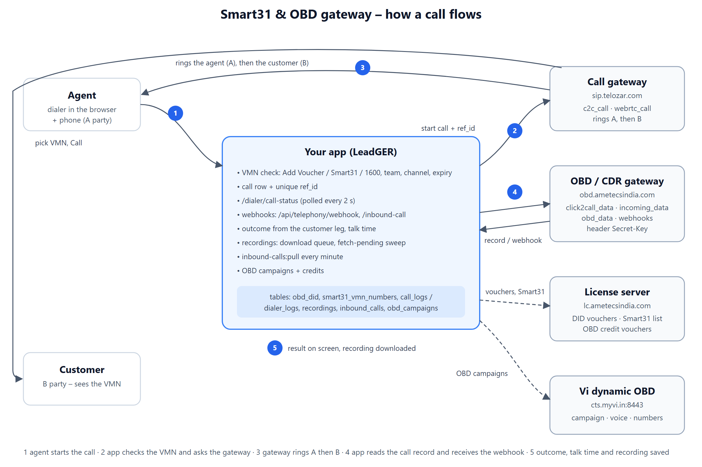

# LeadGER – Smart31 & OBD Gateway Integration Guide

| | |
|---|---|
| **Based on** | The working LeadGER code (Laravel 13, PHP 8.3), branch `main`, October 2026 |
| **Audience** | Developers adding Click2Call, WebRTC calling, Smart31 / Add Voucher VMNs, call records, recordings, inbound calls and OBD campaigns to another project. No LeadGER knowledge needed. |
| **Secrets** | Every key, password and token is a placeholder such as `<TELEPHONY_SECRET>`. Section 9 says where each real value is kept, so your team can fill it in from the source. Phone numbers are shown as `9XXXXXXXXX`. |

**Labels used in this guide**

- **[LeadGER]** – how LeadGER does it today, with the file and line (paths are relative to `core/`).
- **[Gateway]** – what the provider's API expects or sends, as seen in the working code and real payloads.
- **[Proposed]** – recommended for a new project; LeadGER does not do this (yet).

[[TOC]]

## 1. Executive Overview

Four outside systems work together. A new project needs the same four.

| System | Host | What it does |
|---|---|---|
| **Call gateway** | `sip.telozar.com` | Starts calls: Click2Call (rings the agent's phone, then the customer) and WebRTC (browser softphone). |
| **OBD / CDR gateway** | `obd.ametecsindia.com` | Returns call records (who answered, talk time, recording link), inbound call logs and OBD campaign results. Sends call-end webhooks. |
| **License server** | `lc.ametecsindia.com` | Issues the license, the **DID vouchers** (your VMNs), the **Smart31 VMN pool** and the **OBD credit vouchers**. |
| **Vi dynamic OBD** | `cts.myvi.in:8443` | Runs voice-broadcast (OBD) campaigns: create campaign, upload voice, upload numbers. |

How a call works in five sentences:

- The agent picks a **VMN** (the number the customer sees) in the dialer: an Add Voucher number, a **Smart31** pool number, or a **1600** number.
- LeadGER checks the VMN is allowed for that user and channel, saves a call row with a unique **ref_id**, and asks the **call gateway** to place the call.
- The gateway rings the **agent (A party)** first, then the **customer (B party)**.
- While the call runs, the dialer **polls LeadGER**, which reads the call record from the **OBD gateway**. When the call ends, the gateway also sends a **webhook**.
- The record's **customer leg (B)** decides the result: connected or not, the talk time, and the recording link. LeadGER downloads the recording in the background.



> **Most important findings for a new project**
>
> 1. **Move every secret to `.env`.** LeadGER has the provider Secret-Key written into nine files and the license key into eight (section 9). Read them from configuration only.
> 2. **Always check the webhook secret.** LeadGER's call-end webhook accepts requests that send **no** secret (section 4.1). Require it.
> 3. **The provider's times are India time marked as UTC.** `2026-10-24T11:28:45.000000Z` means 11:28 IST. Read them as local time, or calls show 5½ hours late (section 10).

## 2. Concepts

### 2.1 VMN, DID and the three number pools

A **VMN** (virtual mobile number, also called DID) is the caller number the customer sees. Each VMN is enabled per channel.

| Pool | Where it comes from | Table | Channel flags |
|---|---|---|---|
| **Add Voucher numbers** | A DID voucher redeemed on the license server | `obd_did` | `click2call`, `webrtc`, `obd`, `tc_verified` |
| **Smart31 pool** | The license server's Smart31 list for your CRM id, synced daily | `smart31_vmn_numbers` | `c2c`, `webrtc`, `obd`, `verified` |
| **1600 numbers** | Smart31 or Add Voucher numbers with `type = '1600'`, or starting with `1600` / `101` | both | as above |

**[LeadGER]**
- `obd_did.team_id` is a comma list of team ids. A user may only use the VMNs of their teams; Admin and Webmaster may use all (`VmnService.php:81-119`).
- `obd_did.expiry` is stored encrypted (MySQL `AES_ENCRYPT` with `<AES_KEY>`). An expired VMN is refused.
- Smart31 numbers are assigned to teams per **group** (`smart31_vmn_numbers.group_name`, `assigned_groups` = comma list of team ids). An empty list means every team may use them (`VmnService.php:36-56`).
- `VmnService::is1600` (`VmnService.php:24-28`) decides what counts as a 1600 number.

### 2.2 A party and B party

In Click2Call, the gateway first calls the **A party = the agent's phone**. When the agent answers, it calls the **B party = the customer**.

- If the **agent does not answer**, the customer is never dialled. The result is **failed** ("Your phone did not answer").
- If the agent answers but the **customer does not**, the result is **no-answer** or **busy**. The provider may still send a recording of the ringing.
- Only when the **customer answers** is the call **connected**. Talk time = customer connected → customer end.

### 2.3 CRM id and ref_id

- The **CRM id** identifies your installation at the gateway. LeadGER reads it from the license data (`settings.full_response`, encrypted, field `data.crm_id`).
- Every call gets a **ref_id**, sent to the gateway and stored in the call row (`reference_id`). The call record and the webhook come back with the same ref_id, which is how LeadGER finds the call again.

| Call | ref_id format | Where |
|---|---|---|
| Dialer Click2Call | `{uuid}_d_{crm_id}_{user_id}_1` | `DialerController.php:362` |
| Campaign Click2Call | `{lead_id}_M{call_log_id}_{crm_id}_{user_id}_{verified}` (verified = `obd_did.tc_verified`) | `LeadsController.php:687-719` |
| Campaign WebRTC | `{lead_id}_M{call_log_id}_{crm_id}_{user_id}_{verified}` | `WebRTCController.php:197-220` |
| Dialer WebRTC | `{first 8 chars of uuid}_d_{crm_id}_{user_id}_` | `WebRTCController.php:303-346` |

**[Proposed]** Use one format for every call, e.g. `{crm_id}-{call_row_id}-{random}`, and store it in a unique column.

## 3. Outbound API calls (your app → gateway)

### 3.1 Start a Click2Call call

| | |
|---|---|
| **Method / URL** | `POST https://sip.telozar.com/api/webrtc/c2c_call` |
| **Headers** | `Content-Type: application/json` (no auth header in LeadGER today) |
| **[LeadGER]** | `Helper::click2callProviderRequest`, `Helper.php:1358-1568` |

Request body:

```json
{
  "did": "<VMN, 10 digits>",
  "a_party_no": "9XXXXXXXXX",
  "b_party_no": "9XXXXXXXXX",
  "ref_id": "<your ref_id>",
  "record": 1, "recording": 1, "record_call": 1
}
```

- `a_party_no` = the agent's number: `users.click_agent_number`, else `users.mobile`, without the leading `91`.
- `b_party_no` = the customer's number.
- The three record flags are always 1.

Response handling:

- Success = valid JSON without an `error` / `errors` key.
- The provider's call id is the first of `call_id`, `callId`, `uuid`, `response.call_id`, else your ref_id. Store it as `provider_call_id`.
- **[Proposed]** Set a timeout (10–15 s), keep TLS verification on, and send an API key if the gateway offers one.

### 3.2 Start a WebRTC call

| | |
|---|---|
| **Method / URL** | `POST https://sip.telozar.com/api/voip/webrtc_call` |
| **Headers** | `Content-Type: application/json` |
| **Timeouts** | 30 s, connect 10 s |
| **[LeadGER]** | `WebRTCController.php:595-680` |

```json
{ "did": "<VMN>", "agent_id": "<agent's WebRTC id>", "customer_number": "9XXXXXXXXX", "ref_id": "<your ref_id>" }
```

- `agent_id` is the agent's WebRTC id at the gateway (LeadGER: `users.smartping_user_id`, e.g. `100266`). It is created with the gateway's add-agent API.
- **[Gateway]** The gateway refuses `record` on this endpoint (HTTP 400). Recording is configured on the gateway side.
- The browser then registers the SIP softphone and places the call. That part is outside this guide.

### 3.3 Read a call record (live status and recording)

| | |
|---|---|
| **Method / URL** | `GET https://obd.ametecsindia.com/admin/click2call_data/{ref_id}/{vmn}` |
| **Headers** | `Secret-Key: <TELEPHONY_SECRET>` |
| **[LeadGER]** | `DialerController::fetchGatewayCallRecord`, `DialerController.php:1201-1227` (timeout 3 s); `FetchPendingRecordingsCommand.php:163-210` (timeout 5 s) |

Response (shape used by the code):

```json
{
  "status": 200,
  "message": "...",
  "data": {
    "response": "<the call record, often a JSON string>",
    "recording_url": "https://.../recordings/c2c/2026-10-24/<file>.wav",
    "duration": 35
  }
}
```

The call record inside `data.response`:

| Field | Meaning |
|---|---|
| `SERVICE_TYPE` | e.g. `CLICK_TO_CALL` |
| `EVENT_TYPE` | e.g. `Call End` |
| `REF_ID` | your ref_id |
| `A_DIAL_STATUS` / `B_DIAL_STATUS` | agent leg / customer leg: `Connected`, `No Answer`, `Busy`, `Failed` … |
| `A_PARTY_CONNECTED_TIME`, `A_PARTY_END_TIME` | agent leg times, format `dmYHis` (e.g. `24102026112845`) |
| `B_PARTY_CONNECTED_TIME`, `B_PARTY_END_TIME` | customer leg times, same format |
| `DISCONNECTED_BY` | e.g. `Customer` |
| `RecordVoice` | recording link (also for some unanswered calls: the ringing) |

- `data.response` can be a JSON **string**: decode it before reading.
- If the VMN is unknown, LeadGER sends the literal `default` (`FetchPendingRecordingsCommand.php:179`). Whether the provider accepts this is not confirmed.

### 3.4 Pull inbound call logs

| | |
|---|---|
| **Method / URL** | `POST https://obd.ametecsindia.com/admin/incoming_data/` (`.env` `TELEPHONY_INCOMING_URL`) |
| **Headers** | `Secret-Key: <TELEPHONY_SECRET>`, `Accept: application/json` |
| **Timeout / retries** | 30 s; 3 retries on network errors, 429 (honours `Retry-After`) and 5xx |
| **[LeadGER]** | `InboundCallPuller.php:92-151`, run every minute by `inbound-calls:pull --hours=3` |

```json
{ "vmn": ["<VMN 1>", "<VMN 2>"], "crm": ["<crm_id>"], "from": "2026-10-24 08:00:00", "to": "2026-10-24 11:00:00", "page": 1 }
```

- `from` / `to` are **India time** (`TELEPHONY_TIMEZONE`, default `Asia/Kolkata`).
- Response: `{ "status": 200, "data": [rows] }`, or paged `{ "data": { "data": [...], "last_page": N } }`. `status` may be `200`, `success`, `ok`, `1` or `true`.
- Each row has the same fields as the inbound webhook (section 4.2). `recording_url` may be the literal `No Voice`.
- **[LeadGER]** sends only the Add Voucher numbers (`obd_did`), not the Smart31 numbers.

### 3.5 OBD campaign results

| | |
|---|---|
| **Method / URL** | `GET https://obd.ametecsindia.com/admin/obd_data/{vi_campaign_id}` |
| **Headers** | `Secret-Key: <TELEPHONY_SECRET>` |
| **[LeadGER]** | `ObdController::fetchCampaignStatus`, `ObdController.php:682-741` |

```json
{ "status": 200, "data": [ { "customer_number": "9XXXXXXXXX", "call_initiated_time": "...", "call_answered_time": "...",
  "call_end_time": "...", "call_duration": 28, "hangup_cause": "Call Connected", "disconnected_by": "..." } ] }
```

`hangup_cause` values seen: `Call Connected`, `Busy / Switch Off / Out of Coverage`, `No Ring`, `No Answer`, `No Dial Tone`, `Time Out`.

### 3.6 License server: Smart31 list and vouchers

| Call | Method / URL | Auth | Returns |
|---|---|---|---|
| Smart31 VMN list | `GET https://lc.ametecsindia.com/api/smart31-details/{crm_id}` | none | `{ "vmn_details": [ { vmn, usage_date, webrtc, c2c, obd, verified, group_id, type, group_name, assigned_groups } ] }` |
| License | `GET /api/license/{license_key}` | `Secret-Key: <LICENSE_SERVER_SECRET>` | license data incl. `data.crm_id` |
| OBD credit voucher | `GET /api/voucher/{code}` | same | `{ status, message, data: { credits } }` |
| Mark credit voucher used | `GET /api/voucher_used/{code}/{client_ip}` | same | status |
| DID voucher | `GET /api/did_voucher/{code}/{crm_id}` | same | `data: { click2call_did, obd_did, webrtc_did, tc_verified (comma lists), expiry, smart_groups: [...] }` |
| Mark DID voucher used | `GET /api/did_voucher_used/{code}/{client_ip}` | same | status |
| Daily DID check | `GET /api/did_voucher_validate/{code}/{crm_id}` | same | `{ status, deleted: [vmn, ...] }` – remove these VMNs |

**[LeadGER]**
- Smart31 sync: `LicenseService::syncDids` (`LicenseService.php:74-110`, button **Sync Did**) and on the first login of the day (`Helper::dailyValidations`, `Helper.php:1588-1651`).
- A Smart31 row is inserted only if `(vmn, usage_date)` is new. Existing rows are never updated.
- Voucher calls: `vendor/ezywing/Helper.php`.

### 3.7 Vi dynamic OBD (voice broadcast)

All calls go to `https://cts.myvi.in:8443/dynamicobd2/api/...` (`CronsController.php:507-815`).

| Step | Method / path | Auth | Body |
|---|---|---|---|
| 1. Log in | `POST /AuthJwt/Authenticate/` | none | JSON `{ "UserName": "<OBD_USERNAME>", "Password": "<OBD_PASSWORD>" }` → token string |
| 2. Create campaign | `POST /OBDCampaign/CreateCampaign` | `Authorization: Bearer <token>` | XML `<dataset>`: `client_id`, `campname`, `fromdt`, `todt`, `fromtime`, `totime`, `cli` (the VMN), `Retry_interval`, `<flow>` → `Status`, `CampaignId`, `Message` |
| 3. Upload voice | `POST /OBDCampaign/VoiceUpload` | Bearer | multipart `campaignid`, `fileid`, `file` (WAV 8 kHz mono, made with ffmpeg) → `Message = "Voice File Saved"` |
| 4. Upload numbers | `POST /OBDCampaign/UploadBase` | Bearer | XML `<dataset><campaignid/>` + one `<record><msisdn/>…</record>` per number, up to 50 per run |

Results come back through `obd_data` (section 3.5).

## 4. Inbound endpoints (gateway → your app)

### 4.1 Call-end and recording webhook

| | |
|---|---|
| **Routes** | `POST /api/telephony/webhook` (also `/api/recording/callback`, `/api/dialer/callback`, `/api/vi_pingback_api`, `/admin/recording/callback`) |
| **Auth** | Secret in header `Secret-Key` (or `X-Webhook-Secret`, `X-Api-Key`, or `?secret=`), compared with `TELEPHONY_WEBHOOK_SECRET` |
| **[LeadGER]** | `TelephonyWebhookController.php:25-40` → `CallRecordingService::processWebhook`, `CallRecordingService.php:25-275` |

> **[LeadGER] gap:** the secret is only checked **when one is sent** (`CallRecordingService.php:40`); a request without any secret is accepted. **[Proposed]** Reject it with 401.

Fields read (several spellings accepted):

| Meaning | Field names |
|---|---|
| ref_id | `ref_id`, `REF_ID`, `reference_id`, `refId` |
| provider call id | `call_id`, `CALL_ID`, `CallId`, `uniqueid`, `unique_id`, `uuid` |
| customer number | `b_party_no`, `B_PARTY_NO`, `customer_number`, `phone_number`, `mobile` |
| recording link | `recording_url`, `RecordVoice`, `record_voice`, `record_url`, `audio_url`, `file_url` (http/https only) |
| leg statuses | `A_DIAL_STATUS`, `B_DIAL_STATUS`; or one `status` / `call_status` / `dial_status` / `disposition` |
| times / talk time | the `*_PARTY_*_TIME` fields, or `talk_duration` / `billsec` / `duration` |

What happens:

1. **Find the call** by ref_id (manual calls, then campaign calls), then by provider call id, then by number within 24 h (`CallRecordingService.php:397-420`).
2. **Decide the outcome** from the customer leg (`providerCallFacts`, `CallRecordingService.php:340-390`): busy → `busy`; no answer / missed → `no-answer`; fail / cancel / reject → `failed`; answer / connect / completed → `completed`. Empty B leg with an unanswered A leg → `failed`.
3. **Not connected:** save the outcome with talk time 0. If a recording link came (the ringing), keep it as a recording.
4. **Connected:** save talk time, answer and end time, the recording link; create the recording row (unique on `provider_call_id`) and queue the download.
5. Answer `200` with `{status, message}`, `401` for a wrong secret.

### 4.2 Inbound call webhook

| | |
|---|---|
| **Route** | `GET` or `POST /api/telephony/inbound-call` (300 requests/min) |
| **Auth** | **Required**: header `Secret-Key` (or `X-Webhook-Secret`, `X-Api-Key`, or field `secret` / `secret_key`) = `INBOUND_CALLS_WEBHOOK_SECRET` (else `TELEPHONY_WEBHOOK_SECRET`); optional IP allow-list `INBOUND_CALLS_WEBHOOK_IPS` |
| **[LeadGER]** | `InboundCallWebhookController.php:22-99` → `InboundCallService.php` |

- **Body:** one event, a list, or a list inside `data` / `events` / `calls` / `records` / `payload` (at most 200 per request).
- **Logging:** every request is stored first in `inbound_webhook_events`, with secrets removed.

| Meaning | Field names |
|---|---|
| call id | `call_id`, `callid`, `call_sid`, `uniqueid`, `unique_id`, `call_uuid`, `uuid` |
| customer | `cli`, `caller`, `caller_number`, `caller_id`, `customer_number`, `from`, `msisdn` |
| VMN | `dni`, `dnis`, `vmn`, `did`, `virtual_number`, `called_number`, `to` |
| agent | `a_party_no`, `agent_number`, `answered_by`, `agent`, `destination`, `connected_to` |
| start / end | `a_start_time`, `start_time`, `call_start`, `timestamp` … / `a_end_time`, `end_time`, `hangup_time` |
| duration | `duration`, `talk_time`, `billsec`, `call_duration` |
| event / status | `event`, `event_type`, `status`, `call_status`, `a_dial_status`, `dial_status` |

**Status rules:**
- `ringing` → `missed` → `answered`. A call never moves backwards.
- An "ended" event with duration > 0 counts as answered.

**Storage:**
- One `inbound_calls` row per call id, updated by each event.
- The lead is matched by the customer's number.
- The agent is matched by mobile number, Click2Call number or WebRTC agent id (e.g. `100266`).

**Ignored events:**
- The VMN must belong to this company (`obd_did` or `smart31_vmn_numbers`); otherwise the event is ignored.
- Ignored events still get HTTP 200, so the provider doesn't retry.

**Call type:**
- An agent WebRTC id means **WebRTC**; an agent mobile number means **Click2Call**.
- With no agent, the VMN's channel decides (`InboundCallQuery::callType`).

## 5. Flows

### 5.1 Click2Call from the dialer

1. The agent picks a VMN. The **Smart31 Only** and **Enabled 1600** boxes switch the list to that pool; the two exclude each other.
   - Lists: `GET /dialer/get-smart31-vmns?type=click2call|webrtc`, `GET /dialer/get-1600-vmns` → `{ success, vmns: [{number, display, available, expiry}] }`.
2. The browser posts `{mobile, vmn, smart31_enabled, vmn1600_enabled}` to `POST /dialer/click2call` (`DialerController::click2call`, `DialerController.php:243-463`).
3. The server:
   - checks the user's calling permission, the calling hours and the retry limit;
   - takes a per-agent call lock;
   - runs `VmnService::check(user, vmn, 'click2call', pool)` (the VMN is allowed for this user, channel and pool, and not expired);
   - saves the call row with its ref_id;
   - calls the gateway (section 3.1).
4. The browser polls `GET /dialer/call-status?id=…` every 2 s. The server answers from the stored record, or reads it live (section 3.3), and returns `calling` → `ringing` → `connected` → `ended` / `busy` / `no_answer` / `failed`.
5. The call-end webhook (section 4.1) and the recording jobs (section 6) complete the record. Saving the call outcome also closes the call.

### 5.2 Choosing and checking a VMN

| Selected pool | Allowed VMNs (`VmnService::check`, `VmnService.php:129-172`) |
|---|---|
| Smart31 | Smart31 rows flagged for the channel, not 1600, in the user's team groups (or groups with no teams) |
| 1600 | 1600 numbers from Smart31 and Add Voucher, flagged for the channel |
| none | An Add Voucher number flagged for the channel, in the user's teams, not expired – or any Smart31 number flagged for the channel |

**[LeadGER] gaps:**
- WebRTC calls do not pass the selected pool to the check (`WebRTCController.php:297`).
- Campaign WebRTC skips the VMN check.
- The Smart31 pool ignores `usage_date`.

**[Proposed]** Apply the same check to every channel, and filter Smart31 by the current `usage_date`.

### 5.3 Inbound calls

- **Live:** the provider calls `/api/telephony/inbound-call` (section 4.2).
- **Safety net:** `inbound-calls:pull` every minute (section 3.4). Both paths update the same row by call id, so nothing is counted twice.
- **Nightly:** `inbound-calls:rematch` links calls to leads and agents added later.

### 5.4 Recordings

1. The webhook or the status check creates a `recordings` row:
   - `pending` when a link is known;
   - `awaiting` when the call connected but no link has come yet.
2. `DownloadRecordingJob` downloads the file (5 tries, back-off 5 / 15 / 30 / 60 / 120 s, timeout 60 s).
3. `recordings:fetch-pending` (every minute):
   - asks the gateway for `awaiting` rows from the last 24 h;
   - marks them `unavailable` after 60 minutes without a link;
   - re-queues downloads stuck for 3 minutes or more.
4. With `--sweep` (every 5 minutes) it also:
   - retries failed downloads;
   - asks the gateway about recent calls that have no recording row.

### 5.5 OBD campaign

1. **Credits.** An OBD credit voucher is validated with the license server, marked used, and its credits are added to the master balance (`settings.obd_credits`, encrypted). Admins can transfer credits to users (`obd_credits_transfer`).
2. **Create.** Choose an OBD-enabled VMN, a voice file and the numbers (typed, or loaded from CRM campaigns without DND statuses). **Credits per number** = audio seconds ÷ 30, rounded up.
3. **Store.** The schedule window is 09:00–21:00. LeadGER saves the campaign (status 0) and one detail row per number, then deducts `numbers × credits` from the user.
4. **Execute.** `GET /api/obd/execute` runs the Vi steps of section 3.7. It sends 50 numbers per run, marking the campaign 1 (processing) and then 2 (executed).
5. **Results.** **Fetch Status** reads `obd_data` (section 3.5) into the detail rows. When every number has a duration, the campaign becomes 3 (completed).

**[LeadGER] gaps:**
- The deduction does not check the balance.
- Credits per number come from a hidden form field.
- `/api/obd/execute` is not scheduled and has no authentication.

**[Proposed]**
- Compute credits on the server.
- Check and deduct the balance in one transaction.
- Run the executor from the scheduler.

## 6. Scheduled jobs

| Command | Frequency | Purpose |
|---|---|---|
| `recordings:fetch-pending` | every minute | Fetch missing recording links, queue downloads |
| `recordings:fetch-pending --sweep` | every 5 minutes | Retry failures, catch calls the webhook missed |
| `recordings:fetch-pending --sweep --sweep-minutes=1440` | daily 23:30 | Same, for the whole day |
| `inbound-calls:pull --hours=3` | every minute | Inbound call logs from the gateway |
| `inbound-calls:rematch` | daily 02:15 | Link inbound calls to leads and agents added later |

**[LeadGER]** These need **both** a cron entry running `php artisan schedule:run` every minute **and** a queue worker (`php artisan queue:work`, queue connection `database`). Without them, recordings stay "Waiting for recording".

## 7. Data model

The table prefix in LeadGER is `leadger_`.

| Table | Key columns |
|---|---|
| `obd_did` | `virtual_number`, `click2call`, `webrtc`, `obd`, `tc_verified`, `team_id` (comma list), `expiry` (encrypted), `voucher_id` |
| `smart31_vmn_numbers` | `vmn`, `usage_date`, `c2c`, `webrtc`, `obd`, `verified`, `group_id`, `group_name`, `type` (`1600` …), `assigned_groups` (team ids) |
| `call_logs` (campaign) / `dialer_logs` (manual) | `reference_id` (ref_id, unique), `provider_call_id`, `webrtc_call_id`, `vmn_used`, `call_state`, `answer_time`, `end_time`, duration, `click_response` (raw record), `click_recording_url`, `recording_id` |
| `recordings` | `provider_call_id` (unique), `call_log_id` / `dialer_log_id`, `recording_url`, `file_path`, `duration`, `download_status` (`awaiting`, `pending`, `downloading`, `completed`, `failed`, `unavailable`, `deleted`), `download_attempts` |
| `inbound_calls` | `call_id` (unique), `customer_mobile`, `vmn`, `start_time`, `end_time`, `duration_seconds`, `agent_number`, `agent_user_id`, `lead_id`, `status`, `raw_payload` |
| `inbound_webhook_events` | every inbound request: `source`, `headers`, `raw_body` (secrets removed), `processing_status`, `failure_reason` |
| `obd_campaigns` / `obd_campaign_detail` | campaign (`vi_campaign_id`, `did`, `status` 0–3, `credits`, `audio_file`) / one row per number (times, `call_duration`, `hangup_cause`) |
| `obd_credits_history` / `obd_credits_transfer` | vouchers redeemed / credit transfers |
| `users` | `click_agent_number` (Click2Call A party), `smartping_user_id` (WebRTC agent id), `obd_credits` (encrypted), `team_id` |

**[Proposed]**
- Store expiry and credits as plain columns, and protect them with database permissions instead of a shared AES key.
- Add a unique key on `(vmn, usage_date)` in the Smart31 table.

## 8. Configuration

**[LeadGER] `.env` keys** (`config/services.php:77-110`):

```dotenv
# OBD / CDR gateway and webhooks
TELEPHONY_WEBHOOK_SECRET=<TELEPHONY_SECRET>
TELEPHONY_INCOMING_URL=https://obd.ametecsindia.com/admin/incoming_data/
TELEPHONY_TIMEZONE=Asia/Kolkata
INBOUND_CALLS_WEBHOOK_SECRET=<INBOUND_WEBHOOK_SECRET>
INBOUND_CALLS_WEBHOOK_IPS=
# Call gateway (WebRTC / agents)
SMARTPING_URL=https://sip.telozar.com
SMARTPING_COMPANY_ID=<COMPANY_ID>
SIP_DOMAIN=<SIP_DOMAIN>
SIP_WEBSOCKET=<SIP_WEBSOCKET_URL>
```

**[Proposed]** for a new project, add the keys LeadGER still has in code:

```dotenv
LICENSE_SERVER_URL=https://lc.ametecsindia.com
LICENSE_SERVER_SECRET=<LICENSE_SERVER_SECRET>
CALL_GATEWAY_C2C_URL=https://sip.telozar.com/api/webrtc/c2c_call
CALL_GATEWAY_WEBRTC_URL=https://sip.telozar.com/api/voip/webrtc_call
CDR_GATEWAY_URL=https://obd.ametecsindia.com/admin
VI_OBD_URL=https://cts.myvi.in:8443/dynamicobd2/api
VI_OBD_USERNAME=<OBD_USERNAME>
VI_OBD_PASSWORD=<OBD_PASSWORD>
```

**Webhook URLs to give the provider** (one set per company host):

- Call end / recording: `https://<your-host>/api/telephony/webhook`, with header `Secret-Key: <TELEPHONY_SECRET>`.
- Inbound calls: `https://<your-host>/api/telephony/inbound-call`, with header `Secret-Key: <INBOUND_WEBHOOK_SECRET>`.
- Always use **https**: an http URL answers 301, the redirect drops the header, and the call ends in 401.

## 9. Credentials: what they are and where the real values are

The real values are **not** in this document. Take them from these places (or from your provider account) and put them in your new project's `.env` only.

| Placeholder | What it is | Where LeadGER keeps it today |
|---|---|---|
| `<TELEPHONY_SECRET>` | Shared `Secret-Key` for the OBD / CDR gateway and the call-end webhook | Hardcoded in `config/services.php:80`, `CallRecordingService.php:35`, `DialerController.php:1206`, `ObdController.php:691`, `CronsController.php:281, 367, 851, 960`, `FetchPendingRecordingsCommand.php:173`, `ProcessClick2CallLog.php:40` |
| `<INBOUND_WEBHOOK_SECRET>` | Secret for the inbound call webhook | `.env` `INBOUND_CALLS_WEBHOOK_SECRET` (falls back to `<TELEPHONY_SECRET>`) |
| `<LICENSE_SERVER_SECRET>` | `Secret-Key` for the license-server voucher APIs | Hardcoded in `vendor/ezywing/Helper.php:30, 130, 155, 186, 212, 243, 275, 300` |
| `<OBD_USERNAME>` / `<OBD_PASSWORD>` | Vi dynamic OBD login | Hardcoded in `app/Helpers/TcfgHelper.php:6-9` |
| `<AES_KEY>` | Key for MySQL `AES_ENCRYPT` of license data, VMN expiry and credits | Hardcoded in about 20 files, e.g. `VmnService.php:85`, `ObdController.php:226` |
| `<COMPANY_ID>` | The company at the call gateway (agents are created under it) | `.env` `SMARTPING_COMPANY_ID` |
| agent WebRTC id | Per agent, from the gateway's add-agent API | `users.smartping_user_id` |
| CRM id | Your installation at the gateway | License data, `settings.full_response` → `data.crm_id` |

> **Handling the real values:** share them only through a password manager or the server's `.env`, never in chat, email or this document. Whoever has `<TELEPHONY_SECRET>` can read your call records and send fake call results. If a value has been shared openly, ask the provider for a new one.

## 10. Gotchas

1. **India time marked as UTC.** The gateway sends `2026-10-24T11:28:45.000000Z` for 11:28 IST.
   - **[LeadGER]** A UTC-marked time that would be more than 2 minutes in the future is read as local time (`InboundCallService.php:287-292`).
   - Times without an offset are read in `TELEPHONY_TIMEZONE`.
   - Leg times in the call record use `dmYHis`.
2. **Many spellings of the same status:** `Connected` / `ANSWER`, `No Answer` / `NOANSWER`, `BUSY` / `Busy`. Normalise them in one place (`Helper::callStateFromDialStatus`, `Helper.php:159-168`).
3. **The customer leg decides.** Agent answered + customer did not = not connected, talk time 0.
4. **`data.response` may be a JSON string.** Decode it before reading.
5. **Unanswered calls can have a recording.** When the agent answered, the provider records the ringing. Keep it, but don't count talk time.
6. **Manual and campaign calls are two tables with overlapping ids.** Never look a manual call up in the campaign table, or the other way round.
7. **Use https for every gateway URL**, and keep TLS verification on. LeadGER turns it off on most calls; don't copy that.
8. **One host per company.** LeadGER picks the company database from the host name, so each company's webhooks must use that company's own address. An unknown host gets 404.
9. **A DID voucher import replaces all numbers.** LeadGER copies `obd_did` and the Smart31 table to history, then replaces them, which resets team assignments (`ObdController.php:768-823`).
10. **Ignored inbound events still answer 200**, so the provider does not retry them.

## 11. Implementation checklist

[[CHECKLIST]]
